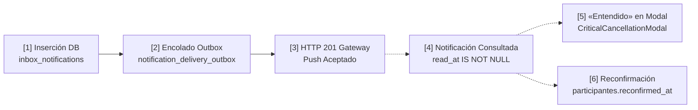

# PuntoEncuentro — Auditoría de Notificaciones Prioritarias y Recordatorios
**Fase Prelanzamiento · Diagnóstico Técnico de Solo Lectura**

---

## 1. Resumen Ejecutivo

### 1.1. Contexto y Estado de Referencia
- **Repositorio:** `puntoxlabs/puntoencuentro`
- **Rama:** `staging`
- **HEAD verificado:** `1b46b9d` (`feat(push): guía de configuración de notificaciones multiplataforma para Windows, macOS y Android`)
- **Base de datos remota auditada (solo lectura):** Supabase Staging (`wougfhfwqgmxhgvjqoua`)
- **Entorno Productivo (`aurbicjwftjhwryhyjiq`):** Estrictamente excluido y protegido.
- **Validación previa:** Circuito Web Push y aprobación de solicitudes en dispositivo móvil físico Android validado previamente en E2E-009.

### 1.2. Síntesis del Diagnóstico
El subsistema de notificaciones de PuntoEncuentro posee una arquitectura desacoplada y robusta basada en **Transactional Outbox (`domain_events_outbox`)**, **Bandeja de Entrada In-App (`inbox_notifications`)** y **Cola de Entrega Push (`notification_delivery_outbox`)**, orquestada de forma asíncrona mediante `pg_net` y la Edge Function `web-push-worker`.

Sin embargo, la auditoría técnica ha identificado **brechas críticas de diseño operativo y entrega** que deben corregirse antes de un lanzamiento masivo:

1. **Riesgo de sobreescritura visual destructiva (P0):** Tanto `public/sw.js` como `web-push-worker` utilizan el tag fijo `pe-notification` para todos los mensajes. Si un participante recibe un aviso de cancelación o cambio de horario urgente y con posterioridad se genera una notificación informativa (ej. coincidencia de Discovery), la notificación crítica es **reemplazada silenciosamente** en el centro de notificaciones del sistema operativo.
2. **Prioridad Web Push homogénea y atenuada (P0):** El worker despacha todas las entregas con el header HTTP `Urgency: normal`. En terminales móviles (Android Chrome) en modo de ahorro de energía o "Doze", los avisos críticos no despiertan la radio celular de inmediato, demorando comunicaciones de último momento.
3. **Fallas activas en Staging del `domain-events-worker` (P0):** Se verificaron 23 eventos fallidos de `encounter.join_request.reminder.v1`, 7 de `encounter.join_request.approved.v1` y 2 de `encounter.participant.withdrawn.v1` en Staging con el error `Unsupported event_type`, debido a desincronización entre las RPCs que generan eventos de dominio y el catálogo de handlers desplegado en la Edge Function.
4. **Ausencia total de Recordatorios de Asistencia Próximos (P1):** No existe ningún proceso programado (`pg_cron`, worker o trigger) para alertar a los participantes 24 horas o 2 horas antes del inicio del encuentro. La reconfirmación de asistencia depende exclusivamente de un disparo manual del anfitrión al cerrar inscripciones o "Hacerlo igual".
5. **Horarios silenciosos circunscritos al frontend (P2):** La lógica de horarios silenciosos (`quietHours.ts`) solo se evalúa en el cliente React cuando la app está abierta en primer plano para alertar coincidencias en vivo. El backend y el worker Web Push carecen de noción de horarios silenciosos y despachan notificaciones 24/7.
6. **Ambigüedad en la Confirmación de Conocimiento (P1):** Cuando un usuario pulsa «Entendido» en el modal de cancelación o cambio (`CriticalCancellationModal.tsx`), el cliente invoca `marcarLeida(id)`, estableciendo `inbox_notifications.read_at`. No existe distinción persistente entre un usuario que acusó recibo formalmente de una cancelación y uno que simplemente abrió la bandeja o pulsó "Marcar todas como leídas".

---

## 2. Matriz de Eventos y Canales

A continuación se detalla el inventario exhaustivo de todos los eventos del dominio, contrastando el código del repositorio con la infraestructura efectivamente desplegada en Supabase Staging (`wougfhfwqgmxhgvjqoua`).

| Evento de Negocio | Origen / Función Responsable | Destinatarios | Registro Inbox (`inbox_notifications`) | Encolado Outbox (`notification_delivery_outbox`) | Web Push (FCM / Mozilla) | Modal Crítico In-App | Deduplicación / Clave | Estado Real Verificado |
| :--- | :--- | :--- | :--- | :--- | :--- | :--- | :--- | :--- |
| **1. Cancelación de Encuentro** | RPC `cancelar_encuentro_seguro` | Participantes confirmados (`encounter_cancelled_for_participant`) y solicitantes pendientes (`open_encounter_request_cancelled_by_host`) | Sí (`priority: 'critical'`, con motivo si existe) | Sí (vía `trg_enqueue_web_push_deliveries`) | Sí (copy genérico, urgency: normal, tag: `pe-notification`) | **Sí** (`CriticalCancellationModal`) | Clave: `canc:<id>:<user_id>` | **Implementado y operativo** |
| **2. Cambio de Fecha / Horario** | RPC `actualizar_encuentro_seguro` | Confirmados (`encounter_schedule_changed` con `priority: 'critical'`) y postulantes pendientes (datos públicos) | Sí (con nuevas fechas y etiquetas formateadas) | Sí | Sí (copy genérico) | **Sí** (para confirmados; postulantes solo en bandeja) | Clave: `sched:<mutation_id>:<user_id>` | **Implementado y operativo** |
| **3. Cambio de Ubicación / Logística** | RPC `actualizar_encuentro_seguro` | Únicamente participantes confirmados (`encounter_logistics_changed`) | Sí | Sí | Sí (copy genérico) | **No** (redirige al detalle seguro del encuentro) | Clave: `logistics:<mutation_id>:<user_id>` | **Implementado y operativo** |
| **4. Confirmación de Realización** | RPC `cerrar_inscripciones_seguro` o `hacerlo_igual_seguro` | Participantes confirmados (`encounter_final_confirmation` o `encounter_realization_forced`) | Sí (`action_required: 'reconfirm'`) | Sí | Sí | **No** (notificación en bandeja con deep-link a detalle) | Clave: `final_conf:<id>:<cycle_id>:<user_id>` | **Implementado y operativo** |
| **5. Solicitud de Unirse Aprobada** | RPC `aprobar_solicitud_encuentro_abierto` | Solicitante (`open_encounter_request_accepted`) | Sí ("¡Solicitud aprobada!") | Sí | Sí | **No** | Clave: `req_acc:<solicitud_id>` | **Implementado y operativo** (validado en E2E-009) |
| **6. Solicitud de Unirse Rechazada** | RPC `rechazar_solicitud_encuentro_abierto` | Solicitante (`open_encounter_request_rejected`) | Sí (con motivo si fue informado) | Sí | Sí | **No** | Clave: `req_rej:<solicitud_id>` | **Implementado y operativo** |
| **7. Solicitud Nueva Entrante** | RPC `solicitar_sumarse_encuentro_abierto` | Anfitrión (`open_encounter_join_requested`) | Sí ("Nueva solicitud para sumarse") | Sí | Sí | **No** | Clave: `req_join:<solicitud_id>` | **Implementado y operativo** |
| **8. Recordatorio de Solicitudes Pendientes (24h)** | Función `procesar_recordatorio_solicitudes_pendientes` ejecutada por `pg_cron` | Anfitrión (`open_encounter_pending_request_reminder`) | Sí ("Recordatorio: solicitud pendiente") | Sí | Sí | **No** | Clave: `join_request_reminder:<req_id>` | **Implementado y operativo** (26 registros reales en Staging) |
| **9. Baja de Participante** | RPC `reconfirmar_asistencia_seguro` (con `p_reconfirmar = false`) | Anfitrión (`encounter_participant_withdrawn`) | Sí (informa nombre y cupos liberados) | Sí | Sí | **No** | Clave: `part_withdrawn:<id>:<event_id>` | **Implementado y operativo** |
| **10. Caída por Debajo del Mínimo** | RPC `reconfirmar_asistencia_seguro` o `set_min_participants_seguro` | Todos los participantes confirmados (`encounter_below_min_participants`) | Sí ("El encuentro volvió a quedar por debajo del mínimo") | Sí | Sí | **No** | Clave: `below_min_part:<id>:<event_id>:<user_id>` | **Implementado y operativo** |
| **11. Mínimo de Cupos Alcanzado** | RPC `aprobar_solicitud_encuentro_abierto` o `set_min_participants_seguro` | Participantes confirmados (`encounter_min_participants_reached`) | Sí | Sí | Sí | **No** | Clave: `min_part_reached:<id>:<user_id>` | **Implementado y operativo** |
| **12. Coincidencia de Discovery (Mis Ganas)** | Trigger / Outbox `encounter.opened.v1` procesado por `domain-events-worker` | Usuarios con intención/alerta compatible (`match_found`) | Sí | Sí | Sí | **No** (si app abierta, toast si no está en horario silencioso) | Clave: `match:<encuentro_id>:<user_id>` | **Implementado y operativo** |
| **13. Intención Convertida a Encuentro** | `domain-events-worker` (`intention.converted_to_encounter.v1`) | Creador de la intención (`interes_convertido`) | Sí | Sí | Sí | **No** | Clave: `intention:<int_id>:encounter:<enc_id>` | **Implementado y operativo** |
| **14. Mensaje Fijado en Tablón** | RPC `destacar_mensaje_encuentro_seguro` | Participantes del encuentro (`encounter_message_highlighted`) | Sí | Sí | Sí | **No** | Clave: `msg_highlighted:<msg_id>:<user_id>` | **Implementado y operativo** |
| **15. Invitación Interna Directa** | RPC `enviar_invitacion_interna_seguro` | Usuario invitado (`internal_invitation`) | Sí | Sí | Sí | **No** | Clave: `inv:<encuentro_id>:<user_id>` | **Implementado y operativo** |
| **16. Recordatorio de Asistencia Previo al Encuentro (24h / 2h)** | *Ninguno* | Participantes confirmados | **No existe** | **No existe** | **No existe** | **No existe** | N/A | **Pendiente / No implementado** |
| **17. Solicitud Programada de Reconfirmación** | *Ninguno* | Participantes confirmados | **No existe** | **No existe** | **No existe** | **No existe** | N/A | **Pendiente / No implementado** |
| **18. Aviso por Falta de Reconfirmación** | *Ninguno* | Participantes con reconfirmación pendiente | **No existe** | **No existe** | **No existe** | **No existe** | N/A | **Pendiente / No implementado** |

---

## 3. Estado de Recordatorios Programados

### 3.1. Diferenciación Estricta entre Recordatorios
Es indispensable distinguir dos dominios conceptuales completamente diferentes:
1. **Recordatorios de Solicitudes Pendientes (Flujo del Anfitrión):** Tienen como objetivo avisar al organizador que alguien solicitó sumarse hace más de 24 horas y aún no fue respondido.
2. **Recordatorios de Asistencia y Encuentros Próximos (Flujo de Participantes y Anfitrión):** Tienen como objetivo avisar a los asistentes confirmados que el encuentro ocurrirá próximamente (ej. en 24 horas o en 2 horas) y solicitar o reiterar la reconfirmación de asistencia.

### 3.2. Auditoría del Recordatorio de Solicitudes Pendientes
- **Función en DB:** `public.procesar_recordatorio_solicitudes_pendientes()` (migración `20261013150000_open_encounter_lifecycle_and_requests_closure.sql#L614-L692`).
- **Condiciones de ejecución:**
  - Solicitudes en `public.solicitudes_encuentro_abierto` con `estado = 'pending'`.
  - Antigüedad: `s.created_at <= now() - interval '24 hours'`.
  - Encuentro asociado `activo`, `is_open = true` y no finalizado (`(e.fecha + e.hora) >= now()`).
  - Deduplicación estricta: `NOT EXISTS` en `inbox_notifications` con `dedup_key = 'join_request_reminder:' || s.id`.
- **Programación en `pg_cron`:**
  - Job: `recordatorio_solicitudes_pendientes_job`.
  - Cadencia: `0 * * * *` (cada hora en punto).
- **Evidencia empírica en Staging (`wougfhfwqgmxhgvjqoua`):**
  - La tabla `inbox_notifications` registra **26 notificaciones** de tipo `open_encounter_pending_request_reminder`.
  - Timestamps observados: `2026-10-13T18:00:00.139561+00:00` y `2026-10-14T21:00:00.076075+00:00`. La marca exacta a los `00.000` segundos confirma la ejecución periódica autónoma mediante el planificador `pg_cron`.
- **Hallazgo técnico y fallo en Outbox:**
  - La función realiza dos inserciones:
    1. Directa a `inbox_notifications` (que a su vez encola el Web Push con éxito).
    2. A `public.domain_events_outbox` con `event_type = 'encounter.join_request.reminder.v1'`.
  - En Staging, la cola `domain_events_outbox` registra **23 filas con status `failed`** para este evento, con el error:
    `Unsupported event_type: encounter.join_request.reminder.v1`.
  - **Causa:** En la Edge Function `domain-events-worker/index.ts`, este evento fue añadido como un no-op explicativo (`lines 69-72`), pero la versión desplegada en Staging durante esas fechas no contaba con ese handler y arrojó excepción permanente. Afortunadamente, como la notificación de usuario se inserta directamente en la base de datos, el usuario no perdió la notificación en el Inbox, pero el outbox de dominio quedó degradado con fallas acumuladas.

### 3.3. Auditoría de Recordatorios de Encuentros Próximos
- **Estado verificado:** **NO EXISTEN en el código ni en la base de datos.**
- No existe ninguna tabla de eventos temporales, ningún job en `pg_cron`, ninguna función de barrido horario para encuentros a 24 horas o 2 horas.
- La confirmación final (`encounter_final_confirmation`) es 100% reactiva a la voluntad del anfitrión de pulsar "Cerrar inscripciones" o "Hacerlo igual". Si el anfitrión no interactúa con la aplicación, los participantes no reciben aviso alguno antes del encuentro.

---

## 4. Auditoría de Prioridades Web Push

### 4.1. Análisis de `supabase/functions/web-push-worker/index.ts`
El worker opera como un consumidor desacoplado con claim concurrente atómico (`claim_web_push_deliveries_seguro` bajo `FOR UPDATE SKIP LOCKED`).

```typescript
// Líneas 192-195 de web-push-worker/index.ts:
await webpush.sendNotification(pushSubscription, payload, {
  TTL: ttl,
  urgency: "normal",
});
```

1. **Urgencia estática `normal`:**
   - La especificación Web Push (RFC 8030) define 4 niveles: `very-low`, `low`, `normal`, `high`.
   - `urgency: "normal"` permite a los servicios de push de los proveedores (FCM en Google Chrome Android, WNS en Edge Windows, APNs en Safari macOS) agrupar entregas o retrasarlas cuando el dispositivo está con batería baja o pantalla apagada ("Doze mode").
   - Para avisos críticos de cancelación o reprogramación dentro de las 24 horas del evento, la falta de `urgency: "high"` compromete la inmediatez de la entrega.
2. **Contrato de claim incompleto:**
   - La RPC `claim_web_push_deliveries_seguro` une `notification_delivery_outbox` con `inbox_notifications`, pero solo proyecta `title`, `body`, `deep_link` y `expires_at`.
   - **No proyecta `notification_type` ni `payload`** (donde se aloja `'priority': 'critical'`). Por ende, el worker no tiene forma de discernir la prioridad del evento sin una modificación aditiva en la RPC.

### 4.2. Análisis de `public/sw.js`
El Service Worker implementa una política deliberadamente mínima (sin caché, sin almacenamiento offline):

```javascript
// Líneas 71-82 de public/sw.js:
const title = 'PuntoEncuentro';
const body = 'Tenés una nueva notificación';

const notificationOptions = {
  body,
  icon: '/icons/icon-192.png',
  badge: '/icons/icon-192.png',
  tag: data.tag || 'pe-notification',
  data: {},
  renotify: true,
};
```

1. **Riesgo crítico del Tag Genérico (`pe-notification`):**
   - En la Web Notification API, cuando llega una notificación con el mismo `tag` que una notificación ya visible, el navegador **reemplaza la existente**.
   - Al usar `pe-notification` para todos los mensajes, cualquier notificación secundaria (ej. recordatorio rutinario o aviso de Discovery) borra inmediatamente del panel visual una notificación crítica previa de cancelación que el usuario aún no había visto.
2. **Ausencia de parámetros sensoriales:**
   - `notificationOptions` no define `vibrate: [200, 100, 200]`, por lo que en terminales Android depende exclusivamente del perfil predeterminado del canal del navegador.
   - No define `timestamp`, perdiendo el orden cronológico real del evento si la entrega por red sufrió latencia.

### 4.3. Análisis del TTL (Time-To-Live)
- En `web-push-worker`:
  ```typescript
  let ttl = 86400; // 24 horas por defecto
  if (delivery.expires_at) {
    const remainingSeconds = Math.floor((new Date(delivery.expires_at).getTime() - Date.now()) / 1000);
    ttl = Math.max(1, Math.min(86400, remainingSeconds));
  }
  ```
- En `insertar_inbox_notification_seguro`:
  `v_expires := COALESCE(p_expires_at, now() + INTERVAL '14 days');`
- **Efecto verificado:** Prácticamente ninguna RPC de negocio pasa `p_expires_at` (salvo invitaciones internas que pasan 7 días). Como `remainingSeconds` de 14 días supera 86400, **todas las notificaciones Web Push se envían con TTL = 86400 (24 horas)**.
- **Riesgo:** Si un encuentro se cancela 1 hora antes de su inicio y el teléfono del participante pasa varias horas apagado o sin señal, al encenderse 18 horas después (cuando el evento ya transcurrió), el gateway push le entregará el mensaje descontextualizado.

---

## 5. Sonidos y Notificaciones Emergentes por Plataforma

Para diseñar mejoras viables, es mandatorio deslindar qué capacidades están bajo el control de la aplicación web y cuáles dependen del navegador o sistema operativo.

```
┌────────────────────────────────────────────────────────────────────────┐
│                        Capas de Control Técnico                        │
├────────────────────────────────┬───────────────────────────────────────┤
│ 1. Controlable por PE          │ Urgency HTTP, Tag, Renotify,          │
│                                │ Patrón de Vibración, Copys seguros,   │
│                                │ Modales in-app, Sonido Web Audio (app)│
├────────────────────────────────┼───────────────────────────────────────┤
│ 2. Solicitado al Usuario       │ Permiso Push, Guía de configuración OS │
│                                │ (Banners, Sonidos, No Molestar)       │
├────────────────────────────────┼───────────────────────────────────────┤
│ 3. Restringido por el SO       │ Canales de notificación Android,      │
│                                │ Estilo Banners/Alertas en macOS,      │
│                                │ Asistente de Concentración Windows,   │
│                                │ Política de Pantalla Bloqueada        │
├────────────────────────────────┼───────────────────────────────────────┤
│ 4. Exclusivo App Nativa        │ Sonidos MP3 personalizados en Push,   │
│                                │ Full-Screen Intents (estilo alarma),  │
│                                │ Encendido forzado de pantalla         │
└────────────────────────────────┴───────────────────────────────────────┘
```

### 5.1. Comportamiento en Android (Google Chrome)
- **Banners emergentes ("Heads-up / Pop on screen"):** Dependen del canal de notificación que Android asigna automáticamente al dominio web. En Android 8+, el usuario debe tener habilitada la opción "Mostrar avisos emergentes" en los ajustes de la categoría del navegador.
- **Sonido y Vibración:** La Web Notification API permite especificar el patrón `vibrate: [300, 100, 300]`, respetado por Chrome en Android si el dispositivo no está en silencio. El sonido emitido es el sonido predeterminado de notificaciones del sistema operativo; **Web Push no permite ejecutar audio personalizado (`.mp3` o `.wav`) con la app cerrada**.
- **Pantalla bloqueada:** La visibilidad del contenido depende de la política de seguridad global de Android ("Ocultar contenido sensible").
- **Modo "No Molestar" (DND):** Silencia completamente cualquier Web Push salvo que el usuario configure a Chrome como aplicación prioritaria en el sistema operativo.

### 5.2. Comportamiento en Windows 10/11 (Chrome / Edge)
- **Banners emergentes (Toast):** Aparecen en la esquina inferior derecha durante un intervalo breve (~5 segundos) y se archivan en el Centro de Notificaciones. Edge tiene una integración nativa superior con Windows Notification Service (WNS) en comparación con Chrome.
- **Sonido:** Utiliza el timbre de aviso de Windows.
- **Asistente de concentración (Focus Assist / No Molestar):** Bloquea los banners cuando el usuario tiene aplicaciones en pantalla completa o durante horas programadas.
- **Vibración:** No soportada en entornos de escritorio.

### 5.3. Comportamiento en macOS (Safari / Chrome)
- **Estilo de alerta:** En macOS (Ventura 13+), el sistema permite dos modalidades por aplicación: *Tiras* (desaparecen solas tras unos segundos) o *Alertas* (permanecen fijas en pantalla hasta que el usuario interactúa). Esta configuración reside exclusivamente en `Ajustes del Sistema -> Notificaciones`.
- **Modos de Concentración:** Silencian por completo las notificaciones web a menos que el navegador esté en la lista blanca del modo activo.
- **Sonidos:** Limitado a un pitido estándar de macOS.

---

## 6. Estado de Confirmación de Conocimiento

### 6.1. La Cadena de Estados Existente
Actualmente, el sistema registra los siguientes hitos de un evento de comunicación:



### 6.2. Brechas de Atribución Identificadas
1. **Push aceptado ≠ Notificación leída:** El HTTP 201 devuelto por FCM al `web-push-worker` certifica que el servidor de Google tomó el payload para entregarlo al endpoint. No garantiza que el teléfono estuviese encendido, que haya sonado o que el usuario lo haya visto.
2. **`read_at` colapsa dos intenciones distintas:**
   - Si el usuario abre la bandeja lateral (`NotificationsSheet.tsx`) y pulsa *"Marcar todo como leído"*, todas las notificaciones reciben `read_at = now()`.
   - Si un usuario lee un aviso crítico en el modal flotante (`CriticalCancellationModal.tsx`) y pulsa «Entendido», la función invoca exactamente la misma llamada: `marcarLeida(id)`.
   - **Consecuencia:** En la base de datos es imposible saber si un usuario reconoció explícitamente la cancelación de un encuentro o si simplemente limpió su bandeja general.
3. **Lectura ≠ Reconfirmación de Asistencia:**
   - La reconfirmación es un estado transaccional en la tabla `participantes` (`reconfirmation_status = 'confirmed'`, `reconfirmed_at = now()`).
   - Una notificación de confirmación (`encounter_final_confirmation`) puede estar marcada como leída (`read_at IS NOT NULL`), pero el participante puede seguir con asistencia pendiente (`reconfirmation_status = 'pending'`).

---

## 7. Preferencias y Horarios Silenciosos

### 7.1. Alcance Real de la Configuración Actual
- **Módulo:** `src/lib/quietHours.ts` y `src/services/userPreferencesService.ts`.
- **Almacenamiento:** `localStorage` (`pe_quiet_hours_prefs:<user_id>`) y sincronización opcional en `raw_user_meta_data`.
- **Regla de negocio formalizada en código:**
  `isCriticalNotification()` evalúa si `notificationType` es `encounter_cancelled_for_participant`, `open_encounter_request_cancelled_by_host`, `encounter_schedule_changed` o tiene `priority: 'critical'`. En esos casos, `shouldSuppressForQuietHours()` retorna `false` (las notificaciones críticas **nunca se silencian**).
- **Vulnerabilidad de alcance:**
  Esta lógica se ejecuta **únicamente en el frontend** dentro del hook de Realtime en `NotificationsContext.tsx#L289-L293` para decidir si se emite un toast de coincidencia de Discovery en vivo.
  - El trigger de base de datos (`trg_enqueue_web_push_deliveries`) **ignora por completo** los horarios silenciosos.
  - La tabla `notification_delivery_outbox` no almacena franja horaria.
  - La Edge Function `web-push-worker` no consulta preferencias y despacha el push al gateway en cualquier momento de la madrugada.

---

## 8. Riesgos de Privacidad y Aislamiento Multicuenta

### 8.1. Razones del Copy Genérico Actual
El copy actual de los Web Push es estrictamente neutro:
`title: "PuntoEncuentro"` / `body: "Tenés una nueva notificación"` / `tag: "pe-notification"` / `deep_link: "/?notifications=1"`.

Esta decisión técnica obedece a protecciones de privacidad indispensables:
1. **Pantalla de bloqueo pública:** Los títulos de encuentros pueden revelar actividades íntimas o sensibles (ej. grupos de apoyo, actividades terapéuticas, afiliación política). Exponerlos en pantalla de bloqueo permite que terceros visualicen datos privados.
2. **Dispositivos compartidos:** Si una persona inicia sesión en un dispositivo prestado y se desconecta sin revocar la suscripción push, un payload que contenga nombres o direcciones exactas quedaría expuesto ante el siguiente usuario del navegador.
3. **Datos en tránsito:** El payload cifrado pasa por servidores de intermediación de terceros (Google, Apple, Mozilla). Un copy neutro garantiza confidencialidad absoluta en tránsito.

### 8.2. Tensiones y Solución Equilibrada
El copy actual perjudica severamente la UX: ante la llegada de "Tenés una nueva notificación", el usuario no sabe si se canceló su encuentro de hoy a la noche o si es una sugerencia semanal de Discovery.

**Solución viable sin violar la privacidad:**
Categorizar el copy genérico por severidad funcional sin incluir variables de contenido sensible (nombres de personas, direcciones ni títulos textuales):
- **Aviso Crítico:** `title: "PuntoEncuentro — Aviso urgente"`, `body: "Hay un cambio crítico o cancelación en tu encuentro. Ingresá para ver los detalles."`
- **Aviso Importante / Recordatorio:** `title: "PuntoEncuentro — Recordatorio"`, `body: "Tenés un encuentro próximo o una confirmación pendiente."`
- **Aviso Informativo:** `title: "PuntoEncuentro"`, `body: "Tenés novedades en tu bandeja de notificaciones."`

---

## 9. Brechas Verificadas (Matriz de Diagnóstico)

| ID | Componente Afectado | Brecha Técnica Verificada | Impacto Operativo |
| :--- | :--- | :--- | :--- |
| **B-01** | `public/sw.js` y `web-push-worker` | Uso del tag estático `pe-notification` en todas las notificaciones. | **Crítico:** Notificaciones no urgentes sobrescriben y ocultan alertas críticas en el panel visual del sistema operativo. |
| **B-02** | `web-push-worker/index.ts` | Urgencia Web Push fija en `normal`. | **Alto:** Terminales móviles en ahorro de batería no reciben cancelaciones de último momento en tiempo y forma. |
| **B-03** | `domain-events-worker` | Handlers faltantes en worker remoto de Staging para `encounter.join_request.reminder.v1`, `approved.v1` y `withdrawn.v1`. | **Alto:** 23 recordatorios y 2 retiros fallaron en `domain_events_outbox` en Staging con `Unsupported event_type`. |
| **B-04** | Backend y Cron Jobs | Inexistencia de recordatorios de asistencia automáticos (24h y 2h antes del encuentro). | **Medio-Alto:** Los participantes no reciben avisos previos salvo que el anfitrión cierre inscripciones manualmente. |
| **B-05** | `web-push-worker` e `inbox_notifications` | TTL Web Push fijo en 24 horas para todos los eventos. | **Medio:** Dispositivos apagados reciben alertas obsoletas cuando el encuentro ya terminó. |
| **B-06** | `inbox_notifications` | Ausencia de estado explícito de acuse de recibo («Entendido») en cancelaciones críticas. | **Medio:** No es posible auditar en backend si el usuario tomó conocimiento efectivo del aviso o solo marcó leída la bandeja. |
| **B-07** | `quietHours.ts` y Backend | Horarios silenciosos restringidos a la interfaz de usuario. | **Bajo-Medio:** Pushes de Discovery se despachan de madrugada interrumpiendo el descanso. |
| **B-08** | Canales Alternativos | Inexistencia de canal de contingencia (Email transaccional) para avisos críticos desatendidos. | **Medio:** Dependencia 100% de que el usuario tenga Web Push activo y no bloqueado por el navegador. |

---

## 10. Propuesta de Mini-Sprints Priorizados (P0 / P1 / P2 / Futuro)

### Mini-Sprint P0: Blindaje de Entrega Crítica e Integridad (Pre-Lanzamiento Inmediato)

#### Propuesta P0-1: Desacoplamiento de Tags Web Push para Evitar Reemplazo Destructivo
- **Problema concreto:** Una notificación informativa posterior borra la notificación de una cancelación crítica en el panel del dispositivo.
- **Evidencia técnica:** `tag: 'pe-notification'` hardcodeado en `public/sw.js#L79` y `web-push-worker/index.ts#L180`.
- **Solución sugerida:**
  - Enviar tag segmentado según categoría:
    - Crítica: `pe-crit-${target_id}`
    - Recordatorio / Estado: `pe-enc-${target_id}`
    - Informativa / Coincidencias: `pe-info`
- **Componentes afectados:** `public/sw.js`, `supabase/functions/web-push-worker/index.ts`, RPC `claim_web_push_deliveries_seguro`.
- **Riesgos de seguridad y privacidad:** Ninguno; no expone datos personales en el tag.
- **Impacto en UX:** Alertas críticas coexisten en el panel sin ser pisadas por avisos secundarios.
- **Dependencias:** Ninguna.
- **Pruebas necesarias:** Envío concurrente de cancelación y match; verificar persistencia de ambos banners en Android y Windows.
- **Complejidad relativa:** Baja (1 día).

#### Propuesta P0-2: Prioridad HTTP `urgency: high` para Eventos Críticos
- **Problema concreto:** Retraso en la entrega de cancelaciones de último momento cuando el dispositivo móvil está en reposo ("Doze mode").
- **Evidencia técnica:** `urgency: "normal"` hardcodeado en `web-push-worker/index.ts#L194`.
- **Solución sugerida:**
  - Proyectar la columna o flag `priority` desde `inbox_notifications` en `claim_web_push_deliveries_seguro`.
  - Si `priority === 'critical'`, despachar con `{ urgency: 'high' }` en `webpush.sendNotification`.
- **Componentes afectados:** `supabase/migrations/` (actualización aditiva de `claim_web_push_deliveries_seguro`), `web-push-worker/index.ts`.
- **Riesgos:** Ninguno.
- **Impacto en UX:** Despacho inmediato y activación de alerta heads-up en terminales móviles.
- **Complejidad relativa:** Baja (0.5 días).

#### Propuesta P0-3: Despliegue y Corrección de Handlers en `domain-events-worker`
- **Problema concreto:** Acumulación de fallas en `domain_events_outbox` ante recordatorios y retiros de participantes en Staging.
- **Evidencia técnica:** 23 eventos `encounter.join_request.reminder.v1` fallados con `Unsupported event_type`.
- **Solución sugerida:**
  - Registrar formalmente en `EVENT_HANDLERS` de `domain-events-worker/index.ts` los handlers no-op/auditoría para `encounter.participant.withdrawn.v1`, `encounter.join_request.reminder.v1`, y re-desplegar la Edge Function en Staging.
- **Componentes afectados:** `supabase/functions/domain-events-worker/index.ts`.
- **Complejidad relativa:** Muy baja (0.5 días).

---

### Mini-Sprint P1: Recordatorios de Asistencia y Acuse de Recibo (Recomendado para Escalamiento)

#### Propuesta P1-1: Proceso Programado de Recordatorios de Asistencia (24h y 2h antes)
- **Problema concreto:** Ausencia total de recordatorios automáticos de encuentros próximos.
- **Evidencia técnica:** Ningún proceso existente en codebase ni en Staging.
- **Solución sugerida:**
  - Crear función RPC `procesar_recordatorios_encuentros_proximos()`.
  - Evaluar encuentros confirmados que inicien en la ventana `[now() + 23h, now() + 25h]` y `[now() + 1h, now() + 3h]`.
  - Enviar recordatorio al anfitrión y participantes confirmados.
  - En el recordatorio de 24h, condicionar el copy a si el participante ya reconfirmó o si tiene la reconfirmación pendiente.
  - Programar en `pg_cron` cada 30 minutos.
  - Deduplicación mediante claves `reminder_24h:<encuentro_id>:<user_id>` y `reminder_2h:<encuentro_id>:<user_id>`.
  - Expiración automática: calcular TTL dinámico al momento del envío para que expire al comenzar el encuentro.
- **Componentes afectados:** Nueva migración aditiva SQL, `pg_cron`.
- **Riesgos:** Sobrecarga de notificaciones si no hay deduplicación estricta; se mitiga con claves deterministas.
- **Impacto en UX:** Reducción drástica del ausentismo y olvidos de participantes.
- **Complejidad:** Media (2-3 días).

#### Propuesta P1-2: Registro Explícito de Acuse de Recibo («Entendido») en Alertas Críticas
- **Problema concreto:** No se puede distinguir en base de datos si el usuario pulsó «Entendido» en el modal crítico o si la notificación se marcó como leída por barrido general.
- **Evidencia técnica:** `CriticalCancellationModal.tsx#L34` invoca `marcarLeida(id)`.
- **Solución sugerida:**
  - Crear RPC `confirmar_conocimiento_notificacion_critica(p_notification_id UUID)`.
  - Actualizar `inbox_notifications` con `acknowledged_at = now()`, registrando la confirmación expresa.
- **Componentes afectados:** Migración SQL (columna aditiva `acknowledged_at`), `notificationService.ts`, `CriticalCancellationModal.tsx`.
- **Complejidad:** Baja (1 día).

#### Propuesta P1-3: Copy Seguro y Descriptivo por Categoría
- **Problema concreto:** "Tenés una nueva notificación" no comunica la urgencia ni motiva la atención en pantalla bloqueada.
- **Solución sugerida:**
  - Adaptar los textos del payload Web Push en el Worker según severidad (sin incluir datos privados del encuentro).
  - Ejemplo crítico: *"Aviso urgente: cancelación o modificación en tu encuentro de PuntoEncuentro"*.
- **Componentes afectados:** `supabase/functions/web-push-worker/index.ts`.
- **Complejidad:** Muy baja (0.5 días).

---

### Mini-Sprint P2: Preferencias Granulares y Canales Alternativos (Consolidación)

#### Propuesta P2-1: Horarios Silenciosos Server-Side
- **Problema concreto:** Pushes de matching despiertan al usuario en horas de descanso.
- **Solución sugerida:**
  - Crear tabla `user_notification_preferences` (o columna en perfil).
  - El trigger de encolado o la RPC de claim pospone la entrega de notificaciones informativas hasta la finalización del horario silencioso. Alertas críticas quedan exentas.
- **Complejidad:** Media (2 días).

#### Propuesta P2-2: Canal Alternativo de Correo Electrónico Transaccional
- **Problema concreto:** Usuarios con Web Push no configurado pierden avisos críticos si no entran a la web.
- **Solución sugerida:**
  - Integrar proveedor transaccional (ej. Resend / Postmark / Supabase SMTP) mediante Edge Function consumidora de outbox para el canal `email`.
  - Regla: Enviar email únicamente para avisos críticos (cancelación) que no fueron acusados de recibo tras 2 horas de emitidos si restan menos de 12 horas para el encuentro.
- **Complejidad:** Media (3 días).

---

### Futuro: Capacidades Nativas Avanzadas
- **WhatsApp Business API:** Para contingencias operativas de último momento mediante proveedor oficial (Meta Cloud API).
- **PWA Instalable Avanzada / Contenedor Nativo:** Canales de notificación Android con control granular de sonido (`IMPORTANCE_HIGH`), vibración personalizada y badges numéricos en el icono de la aplicación (Badging API).

---

## 11. Conclusión y Detención Técnica
La infraestructura actual de PuntoEncuentro posee cimientos transaccionales sólidos. Las fallas de visibilidad y riesgo de comunicaciones perdidas radican en configuraciones específicas del Worker (`urgency`, `tag` fijo y TTL homogéneo) y en la falta del proceso programado de recordatorios previos al evento.

El presente informe contiene el diagnóstico técnico completo sin modificaciones sobre el repositorio ni sobre el entorno remoto de Staging.

**Estado:** DETENIDO — Esperando evaluación y directivas del equipo. NO IMPLEMENTAR CAMBIOS.