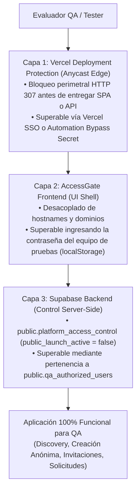

# Guía Operativa: Acceso y Pruebas de QA Manual durante PRE-LAUNCH

> [!IMPORTANT]
> **Estado de Protección Activo:** Durante la fase PRE-LAUNCH, tanto Staging como Producción están completamente cerrados al público externo. Este documento detalla cómo los evaluadores y testers autorizados pueden realizar pruebas manuales completas (incluyendo creación anónima y exploración de Discovery) sin habilitar el acceso a usuarios no autorizados.

---

## 1. Arquitectura de Defensa en Profundidad (3 Capas)

Para que un evaluador pueda interactuar con la aplicación, debe atravesar tres barreras independientes:



---

## 2. Paso a Paso para Habilitar a un Evaluador Manual

### Paso 1: Acceso Perimetral (Vercel)
El evaluador debe poder sortear la pantalla de login de Vercel en `staging.puntoencuentro.com.ar`:
* **Opción A (Recomendada para miembros del equipo):** Iniciar sesión en Vercel con la cuenta invitada al equipo.
* **Opción B (Para testers externos o dispositivos de prueba):** Utilizar un enlace con el token de bypass de automatización generado desde el Dashboard de Vercel o configurando la cookie `x-vercel-set-bypass-cookie` con el valor de `VERCEL_AUTOMATION_BYPASS_SECRET`.

### Paso 2: Desbloqueo de Interfaz (AccessGate)
Al cargar la aplicación en el navegador:
1. Aparecerá la pantalla con el isotipo de PuntoEncuentro y el texto: *«Acceso de pruebas. Este sitio se encuentra en etapa de pruebas. Ingresá la contraseña para continuar.»*
2. El evaluador ingresa la contraseña acordada para el equipo.
3. El frontend valida el hash SHA-256 (`298f4c329ee837515da80384316468597749d103d18f0a0cec8b8ae732088b19`).
4. Al acertar, se asienta la credencial en `localStorage` (`puntoencuentro_test_access_v1`), y el shell de la aplicación se despliega inmediatamente sin volver a pedir contraseña en esa sesión.

### Paso 3: Autorización Server-Side en Supabase (Backend)
Debido a que `public_launch_active = false`, un evaluador que no esté registrado en la base de datos verá listas de Discovery vacías (`[]`) y recibirá `pre_launch_creation_restricted` al intentar crear un encuentro.

Para autorizar al evaluador sin abrir el backend al público:

#### A. Evaluador con Cuenta Permanente (Email o Google)
1. El evaluador inicia sesión en la aplicación con su email.
2. Un operador o administrador ejecuta el script CLI en la terminal del repositorio:
   ```bash
   npx --workspaces=false tsx scripts/authorize-qa-tester.ts --email <email_del_tester>
   ```
   *(O mediante consulta SQL directa en Supabase Staging:)*
   ```sql
   INSERT INTO public.qa_authorized_users (user_id, role)
   SELECT id, 'qa' FROM auth.users WHERE email = '<email_del_tester>'
   ON CONFLICT (user_id) DO NOTHING;
   ```
3. A partir de ese instante, la RPC server-side `is_qa_authorized()` devuelve `true` para ese usuario, habilitando Discovery completo y creación de encuentros.

#### B. Evaluador Probando Creación Anónima
Para verificar el flujo de creación sin registro previo sin comprometer el cierre pre-lanzamiento:
1. El evaluador entra a la aplicación y hace clic en **«Crear encuentro»**.
2. La aplicación invoca `supabase.auth.signInAnonymously()`, asignando un `auth.uid()` a la sesión.
3. El evaluador copia su identificador anónimo (visible en la consola del navegador ejecutando `JSON.parse(localStorage.getItem('sb-wougfhfwqgmxhgvjqoua-auth-token')).user.id` o en la sección de soporte).
4. El operador autoriza ese UUID:
   ```bash
   npx --workspaces=false tsx scripts/authorize-qa-tester.ts --user-id <uuid_de_la_sesion>
   ```
5. La sesión anónima queda autorizada para crear encuentros y explorar Discovery.
6. **Invariante de Seguridad:** Ninguna otra sesión anónima del público general puede operar; cualquier usuario anónimo externo no listado en `qa_authorized_users` sigue 100% bloqueado.
7. Cuando en el futuro se autorice `PUBLIC-LAUNCH` (`public_launch_active = true`), todas las sesiones anónimas funcionarán de manera idéntica y transparente, confirmando que la prueba de QA es 100% representativa de producción.

---

## 3. Higiene y Ciclo de Vida No Destructivo para Fixtures Manuales

Todo evaluador manual debe seguir las directivas de [.agents/rules/staging-qa-fixtures.md](file:///c:/Users/Minar/Documents/Proyectos/PuntoEncuentro/.agents/rules/staging-qa-fixtures.md):

1. **Prefijo Obligatorio:** Todo encuentro manual debe titularse con el prefijo `[QA-TMP]`:
   * Ejemplo: `[QA-TMP] Prueba flujo creación móvil`
2. **Prohibición de `DELETE`:** Jamás eliminar registros de la tabla `encuentros`. La limpieza se realiza actualizando `is_open = false` conservando `estado = 'activo'`.
3. **Lista Blanca Inviolable:** Están estrictamente protegidos los **26 fixtures preexistentes** (8 de Leandro Vega, 6 inciertos, 5 moderados y 7 funcionales/E2E).
4. **Revocación de Permisos:** Al concluir el ciclo de pruebas de un tester temporal, revocar el acceso:
   ```bash
   npx --workspaces=false tsx scripts/authorize-qa-tester.ts --revoke <uuid_del_tester>
   ```
