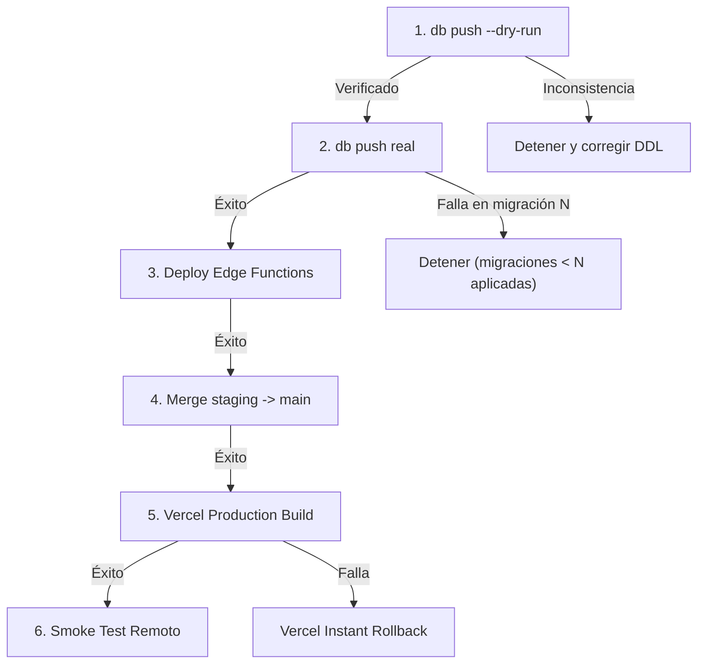

# Plan Corregido de Promoción a Producción — PuntoEncuentro V1

> **Objetivo:** Ejecutar una promoción espejo segura, simple, reproducible y sin riesgo de regresión ni pérdida de datos desde Staging (`wougfhfwqgmxhgvjqoua`) hacia Producción (`aurbicjwftjhwryhyjiq`).  
> **Estado:** Documento operativo de referencia para el futuro despliegue. **AUDITORÍA DE SOLO LECTURA: NO EJECUTAR OPERACIONES SOBRE PRODUCCIÓN EN ESTA TAREA**.

---

## 1. Principios de Seguridad y Aclaraciones Críticas

### 1.1 El historial remoto manda sobre el conteo de Git
No se debe asumir que el diferencial de migraciones en Git corresponde exactamente a las migraciones pendientes en la base remota. El estado real debe ser inspeccionado en la tabla `supabase_migrations.schema_migrations` del proyecto destino.

### 1.2 No ejecutar `migration repair` preventivamente
El comando `migration repair` no es un paso rutinario. Solo se debe invocar si la inspección remota confirma que la migración baseline `20260424000000` no figura registrada en `schema_migrations` y las tablas históricas ya existen en Producción.

> [!WARNING]
> ### 1.3 Ausencia de Transacción Global Única en Migraciones Secuenciales
> En Supabase CLI y PostgreSQL, la aplicación de múltiples migraciones **NO constituye una única transacción atómica global**.
> - Cada archivo `.sql` se ejecuta en su propia transacción delimitada (`BEGIN; ... COMMIT;`).
> - Si se aplican en secuencia 50 migraciones y la migración N° 35 falla por un error de sintaxis o constraint, **las 34 migraciones previas quedan aplicadas y confirmadas permanentemente en la base de datos**. Solo la migración 35 aborta.
> - **NO existe rollback automático del lote completo.** Por esta razón, la ejecución previa de `--dry-run` y la verificación de sintaxis es un prerrequisito indispensable antes de disparar la aplicación real.

### 1.4 Delimitación del Rollback
El script `restore-production-backup-local` es una herramienta para montar y examinar backups en un PostgreSQL **local** de desarrollo. En Supabase remoto, el rollback ante contingencias se gestiona mediante:
- **Frontend:** Instant Rollback en Vercel (1 clic al deployment anterior de `main`).
- **Edge Functions:** Re-despliegue de la versión estable previa (`supabase functions deploy`).
- **Base de Datos:** Al no existir rollback global, ante una falla parcial se debe corregir la migración fallida y aplicar un *forward fix* aditivo, o restaurar un backup lógico mediante `psql` sobre la cadena de conexión administrativa (`--db-url`).

### 1.5 Cero fixtures de prueba en migraciones
Se ha auditado formalmente que ninguna de las 154 migraciones en `supabase/migrations/` contiene datos ficticios, usuarios de test (`@puntoencuentro.test`) ni encuentros de prueba. Todo `INSERT INTO` versionado corresponde exclusivamente a catálogos operativos esenciales (`localidades`, `rate_limit_policies`, bucket `custom-invitation-templates`).

### 1.6 Sintaxis Validada de Supabase CLI 2.122.0
Los comandos han sido verificados contra la especificación real de la CLI instalada (`2.122.0`):
- `supabase link --project-ref <ref>`: Vincula la CLI al proyecto destino.
- `supabase migration list --linked` o `supabase migration list --project-ref <ref>`: Lista estado local vs remoto.
- `supabase migration repair --status applied <version> --linked` (o `--project-ref <ref>`): Actualiza metadata sin ejecutar SQL.
- `supabase db push --linked --dry-run` (o `--project-ref <ref> --dry-run`): Simula la aplicación sin mutar la base.
- `supabase db push --linked` (o `--project-ref <ref>`): Aplica migraciones confirmadas.

---

## 2. Puntos de Control Previos (Pre-Flight Checks)

Antes de cualquier operación que altere Producción:

### Control 1: Generación del Respaldo Preventivo de Producción
Ejecutar el script de respaldo local para resguardar DDL, datos y storage de Producción:
```powershell
.\scripts\backup-production.bat
```
- **Criterio de Aceptación:** La salida de terminal debe indicar `BACKUP OK` y validar los hashes criptográficos en `SHA256SUMS.txt`.

### Control 2: Inspección del Historial Remoto de Migraciones
Consultar la lista de migraciones registradas en Producción:
```bash
npx --workspaces=false supabase migration list --project-ref aurbicjwftjhwryhyjiq
```
- **Evaluación del Baseline `20260424000000`:**
  - **Caso A (Ya aplicada):** Si `20260424000000` figura en el historial remoto de Producción -> **NO HACER NADA**. Continuar directamente al Paso 3.
  - **Caso B (Ausente pero tablas ya existen):** Si `20260424000000` no figura en el historial y la tabla `public.encuentros` ya existe con los 83 registros históricos de abril de 2026 -> Ejecutar puntualmente:
    ```bash
    npx --workspaces=false supabase migration repair --status applied 20260424000000 --project-ref aurbicjwftjhwryhyjiq
    ```

### Control 3: Verificación de Extensiones en Supabase Dashboard
Acceder a: `Dashboard -> Project aurbicjwftjhwryhyjiq -> Database -> Extensions`.
- [ ] **`pg_cron`:** Confirmar que esté en estado **Active**.
- [ ] **`pg_net`:** Confirmar que esté en estado **Active**.
*(Nota: Si `pg_cron` estuviera inactivo, las migraciones se ejecutarán pero los 7 jobs automáticos quedarán omitidos silenciosamente).*

### Control 4: Configuración de Secretos y Variables

#### A. En Supabase Dashboard -> Settings -> Edge Functions -> Secrets:
Confirmar la presencia de las siguientes variables de entorno en Producción:
- `OPENAI_API_KEY`
- `GEMINI_API_KEY`
- `MISTRAL_API_KEY`
- `DEEPSEEK_API_KEY`
- `VAPID_PUBLIC_KEY`
- `VAPID_PRIVATE_KEY`
- `VAPID_SUBJECT` (ej. `mailto:soporte@puntoencuentro.com.ar`)
- `WEB_PUSH_WORKER_SECRET` (token criptográfico aleatorio seguro)
- `DOMAIN_EVENTS_WORKER_SECRET` (token criptográfico aleatorio seguro)

#### B. En Supabase Vault (`vault.decrypted_secrets`):
Ejecutar en el SQL Editor de Producción para vincular la base de datos con los workers:
```sql
SELECT vault.create_secret(
  'https://aurbicjwftjhwryhyjiq.supabase.co/functions/v1/web-push-worker',
  'web_push_worker_url'
);

SELECT vault.create_secret(
  '<MISMO_VALOR_DE_WEB_PUSH_WORKER_SECRET>',
  'web_push_worker_secret'
);

SELECT vault.create_secret(
  'https://aurbicjwftjhwryhyjiq.supabase.co/functions/v1/domain-events-worker',
  'domain_events_worker_url'
);

SELECT vault.create_secret(
  '<MISMO_VALOR_DE_DOMAIN_EVENTS_WORKER_SECRET>',
  'domain_events_worker_secret'
);
```

#### C. En Google Cloud Console (OAuth 2.0 Client ID):
Confirmar en `console.cloud.google.com`:
- **Orígenes autorizados de JavaScript:**
  - `https://puntoencuentro.com.ar`
- **URIs de redireccionamiento autorizados:**
  - `https://aurbicjwftjhwryhyjiq.supabase.co/auth/v1/callback`

---

## 3. Procedimiento Secuencial de Promoción

Una vez superados todos los Controles Previos:



### Paso 1: Simulación de Base de Datos (`--dry-run`)
Antes de mutar Producción, simular la corrida de migraciones:
```bash
# Opción explícita por project-ref:
npx --workspaces=false supabase db push --project-ref aurbicjwftjhwryhyjiq --dry-run
```
- **Punto de Control:** Auditar la lista de archivos que el CLI propone aplicar. Confirmar que no existan colisiones de esquema ni omisiones inesperadas.

### Paso 2: Aplicación Real de Migraciones
Aplicar el lote de migraciones confirmadas:
```bash
npx --workspaces=false supabase db push --project-ref aurbicjwftjhwryhyjiq
```
- **Punto de Control:** Verificar que la salida concluya con `Finished supabase db push` sin errores.  
  *Si falla:* Recordar que las migraciones anteriores a la falla ya quedaron commiteadas. **NO forzar reintentos ciegas**. Diagnosticar el error exacto reportado por PostgreSQL.

### Paso 3: Despliegue de Edge Functions
Desplegar las 4 funciones del backend serverless:
```bash
npx --workspaces=false supabase functions deploy ai-interpret --project-ref aurbicjwftjhwryhyjiq
npx --workspaces=false supabase functions deploy domain-events-worker --project-ref aurbicjwftjhwryhyjiq
npx --workspaces=false supabase functions deploy moderate-public-content --project-ref aurbicjwftjhwryhyjiq
npx --workspaces=false supabase functions deploy web-push-worker --project-ref aurbicjwftjhwryhyjiq
```
- **Punto de Control:** Cada función debe informar `Deployed Function <name>`.

### Paso 4: Promoción Git y Despliegue Frontend
Promover los cambios desde la rama `staging` hacia `main`:
```bash
git checkout main
git pull origin main
git merge origin/staging --ff-only
git push origin main
```
- **Punto de Control:** Vercel detectará el nuevo push en la rama `main` y ejecutará la compilación de producción para `https://puntoencuentro.com.ar`.

---

## 4. Checklist Definitivo de Apertura Pública

Previo a declarar el lanzamiento abierto y recibir tráfico masivo de usuarios reales:

- [ ] **1. Desactivar AccessGate en Producción (preservando Staging):**
  En `src/components/AccessGate.tsx`, asegurar que la barrera de contraseña de acceso de pruebas esté desactivada para Producción (ej. condicionando `ENABLE_TEST_ACCESS_GATE = import.meta.env.VITE_APP_ENV === 'staging'` o `window.location.hostname.includes('staging')`), de modo que `puntoencuentro.com.ar` no solicite contraseña a usuarios reales mientras `staging.puntoencuentro.com.ar` permanece protegida.
- [ ] **2. Publicar Páginas Legales Aprobadas:**
  Completar los datos societarios/jurisdiccionales en `docs/PROPUESTA_PAGINAS_LEGALES_V1.md` y publicar las pantallas correspondientes en la aplicación para cumplir los requisitos de Google OAuth y transparencia a usuarios.
- [ ] **3. Verificar Configuración Real de Idiomas:**
  Constatar que la aplicación responda de manera nativa en Español (ES) con fallback en Inglés (EN), y verificar que no se exponga selector de Portugués (PT/PT-BR) en la interfaz pública hasta completar las 246 claves pendientes.
- [ ] **4. Confirmar Identidad Visual e Íconos PWA / Push:**
  Verificar que los iconos `icon-192.png`, `icon-512.png` y maskables se presenten correctamente en la instalación de la PWA, y validar que el badge de notificación en la barra de estado de Android sea nítido y legible.
- [ ] **5. Validar Web Push en Android Físico (Nivel 4 de Notificaciones):**
  Ejecutar la prueba en un celular Android físico con pantalla bloqueada en red móvil, constatando recepción del banner nativo del sistema operativo y navegación post-click hacia `/solicitudes?open_encounter=:id`.
- [ ] **6. Identificador de Build en Producción:**
  En el pie de página de `https://puntoencuentro.com.ar`, verificar que se visualice la leyenda `Build: <fecha/hora>` y **NO** la etiqueta `STAGING · <hash>`.
- [ ] **7. Verificación de Deep Links de Anfitrión:**
  Abrir `/solicitudes?open_encounter=<id>` siendo el anfitrión y comprobar que cargue la logística privada completa sin error 500.
- [ ] **8. Monitoreo de Logs:**
  Monitorear `Supabase Dashboard -> Logs -> Edge Functions` y confirmar que no existan errores 500 por secrets no configurados.
