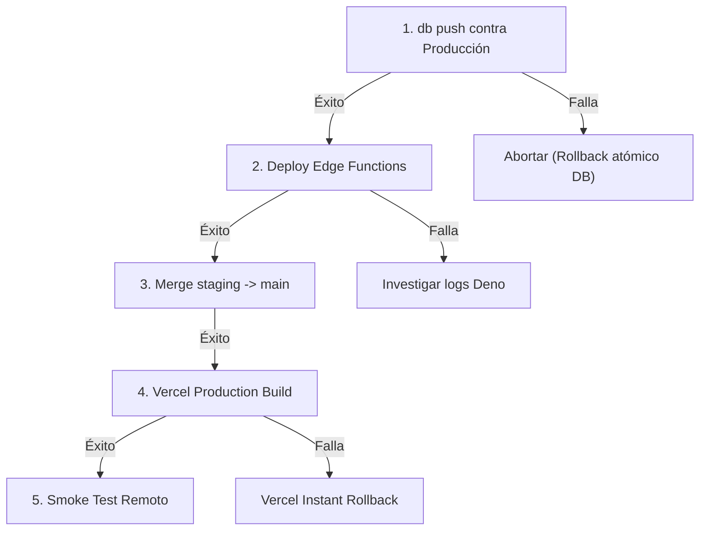

# Plan Corregido de Promoción a Producción — PuntoEncuentro V1

> **Objetivo:** Ejecutar una promoción espejo segura, simple, reproducible y sin riesgo de regresión ni pérdida de datos desde Staging (`wougfhfwqgmxhgvjqoua`) hacia Producción (`aurbicjwftjhwryhyjiq`).  
> **Estado:** Documento operativo de referencia para el futuro despliegue. **NO EJECUTAR DURANTE ESTA TAREA**.

---

## 1. Principios de Seguridad y Aclaraciones Críticas

1. **El historial remoto manda sobre el conteo de Git:**  
   No se debe asumir que el diferencial de migraciones en Git corresponde exactamente a las migraciones pendientes en la base remota. El estado real debe ser inspeccionado en la tabla `supabase_migrations.schema_migrations` del proyecto destino.
2. **No ejecutar `migration repair` preventivamente:**  
   El comando `migration repair` no es un paso rutinario. Solo se debe invocar si la inspección remota confirma que la migración baseline `20260424000000` no figura registrada en `schema_migrations` y las tablas históricas ya existen.
3. **Delimitación del Rollback:**  
   El script `restore-production-backup-local` es una herramienta de restauración y examen en entornos PostgreSQL **locales** de desarrollo. En Supabase remoto, el rollback ante contingencias se gestiona mediante:
   - **Frontend:** Instant Rollback en Vercel (1 clic al deployment anterior de `main`).
   - **Base de Datos:** Transaccionalidad atómica por migración (`db push` aborta si una sentencia falla) o aplicación de migración aditiva correctiva (*forward fix*).
4. **Cero fixtures de prueba:**  
   Se ha verificado que ninguna de las migraciones SQL en `supabase/migrations/` contiene datos ficticios ni usuarios de prueba. Todo `INSERT INTO` corresponde exclusivamente a catálogos operativos (`localidades`, `rate_limit_policies`, buckets de storage).
5. **Compatibilidad de CLI:**  
   Los comandos detallados a continuación están validados para la versión instalada de Supabase CLI (`2.122.0`).

---

## 2. Puntos de Control Previos (Pre-Flight Checks)

Antes de cualquier operación que altere Producción:

### Control 1: Generación del Respaldo Preventivo de Producción
Ejecutar el script de respaldo local para resguardar DDL, datos y storage de Producción:
```powershell
.\scripts\backup-production.bat
```
- **Criterio de Aceptación:** La salida de terminal debe indicar `BACKUP OK` y validar los hashes criptográficos en `SHA256SUMS.txt`.

### Control 2: Inspección del Historial Remoto de Migraciones
Consultar la lista de migraciones registradas en Producción:
```bash
npx --workspaces=false supabase migration list --project-ref aurbicjwftjhwryhyjiq
```
- **Evaluación del Baseline `20260424000000`:**
  - **Caso A (Ya aplicada):** Si `20260424000000` figura en el historial remoto -> **NO HACER NADA**. Continuar directamente al Paso 3.
  - **Caso B (Ausente pero tablas ya existen):** Si `20260424000000` no figura en el historial y la tabla `public.encuentros` ya existe con los 83 registros históricos -> Ejecutar puntualmente:
    ```bash
    npx --workspaces=false supabase migration repair --status applied 20260424000000 --project-ref aurbicjwftjhwryhyjiq
    ```

### Control 3: Verificación de Extensiones en Supabase Dashboard
Acceder a: `Dashboard -> Project aurbicjwftjhwryhyjiq -> Database -> Extensions`.
- [ ] **`pg_cron`:** Confirmar que esté en estado **Active**.
- [ ] **`pg_net`:** Confirmar que esté en estado **Active**.
*(Nota: Si `pg_cron` estuviera inactivo, las migraciones se ejecutarán pero los 7 jobs automáticos no se programarán).*

### Control 4: Configuración de Secretos y Variables

#### A. En Supabase Dashboard -> Settings -> Edge Functions -> Secrets:
Confirmar la presencia de las siguientes variables de entorno:
- `OPENAI_API_KEY`
- `GEMINI_API_KEY`
- `MISTRAL_API_KEY`
- `DEEPSEEK_API_KEY`
- `VAPID_PUBLIC_KEY`
- `VAPID_PRIVATE_KEY`
- `VAPID_SUBJECT` (ej. `mailto:soporte@puntoencuentro.com.ar`)
- `WEB_PUSH_WORKER_SECRET` (token criptográfico aleatorio seguro)
- `DOMAIN_EVENTS_WORKER_SECRET` (token criptográfico aleatorio seguro)

#### B. En Supabase Vault (`vault.decrypted_secrets`):
Ejecutar en el SQL Editor de Producción para vincular la base de datos con los workers:
```sql
SELECT vault.create_secret(
  'https://aurbicjwftjhwryhyjiq.supabase.co/functions/v1/web-push-worker',
  'web_push_worker_url'
);

SELECT vault.create_secret(
  '<MISMO_VALOR_DE_WEB_PUSH_WORKER_SECRET>',
  'web_push_worker_secret'
);

SELECT vault.create_secret(
  'https://aurbicjwftjhwryhyjiq.supabase.co/functions/v1/domain-events-worker',
  'domain_events_worker_url'
);

SELECT vault.create_secret(
  '<MISMO_VALOR_DE_DOMAIN_EVENTS_WORKER_SECRET>',
  'domain_events_worker_secret'
);
```

#### C. En Google Cloud Console (OAuth 2.0 Client ID):
Confirmar en `console.cloud.google.com`:
- **Orígenes autorizados de JavaScript:**
  - `https://puntoencuentro.com.ar`
- **URIs de redireccionamiento autorizados:**
  - `https://aurbicjwftjhwryhyjiq.supabase.co/auth/v1/callback`

---

## 3. Procedimiento Secuencial de Promoción

Una vez superados todos los Controles Previos:



### Paso 1: Aplicación de Migraciones en Base de Datos
Aplicar el lote de migraciones validadas:
```bash
npx --workspaces=false supabase db push --project-ref aurbicjwftjhwryhyjiq
```
- **Punto de Control:** Verificar que la salida concluya con `Finished supabase db push` sin errores.  
  *Si falla:* El proceso se detiene automáticamente en la migración fallida. No avanzar al Paso 2.

### Paso 2: Despliegue de Edge Functions
Desplegar las 4 funciones del backend serverless:
```bash
npx --workspaces=false supabase functions deploy ai-interpret --project-ref aurbicjwftjhwryhyjiq
npx --workspaces=false supabase functions deploy domain-events-worker --project-ref aurbicjwftjhwryhyjiq
npx --workspaces=false supabase functions deploy moderate-public-content --project-ref aurbicjwftjhwryhyjiq
npx --workspaces=false supabase functions deploy web-push-worker --project-ref aurbicjwftjhwryhyjiq
```
- **Punto de Control:** Cada función debe informar `Deployed Function <name>`.

### Paso 3: Promoción Git y Despliegue Frontend
Promover los cambios desde la rama `staging` hacia `main`:
```bash
git checkout main
git pull origin main
git merge origin/staging --ff-only
git push origin main
```
- **Punto de Control:** Vercel detectará el nuevo push en la rama `main` y ejecutará la compilación de producción para `https://puntoencuentro.com.ar`.

---

## 4. Verificación Post-Despliegue (Smoke Test en Producción)

Comprobar inmediatamente en `https://puntoencuentro.com.ar`:

1. **Identificador de Versión:**
   En el pie de página de la Home, constatar que figure la leyenda de producción (`Build: <fecha/hora>`) y **NO** la etiqueta `STAGING · <hash>`.
2. **Autenticación:**
   Iniciar sesión con Google OAuth y constatar redirección limpia sin advertencias de origen inválido.
3. **Flujo de Creación:**
   Crear un encuentro privado y uno abierto; constatar que persistan correctamente en Supabase Producción.
4. **Deep Link del Anfitrión:**
   Abrir `/solicitudes?open_encounter=<id>` siendo el anfitrión; constatar que cargue el encuentro sin error 500.
5. **Edge Functions y Logs:**
   Acceder a `Dashboard -> Logs -> Edge Functions` y verificar que las invocaciones no presenten errores 500 por credenciales faltantes.
