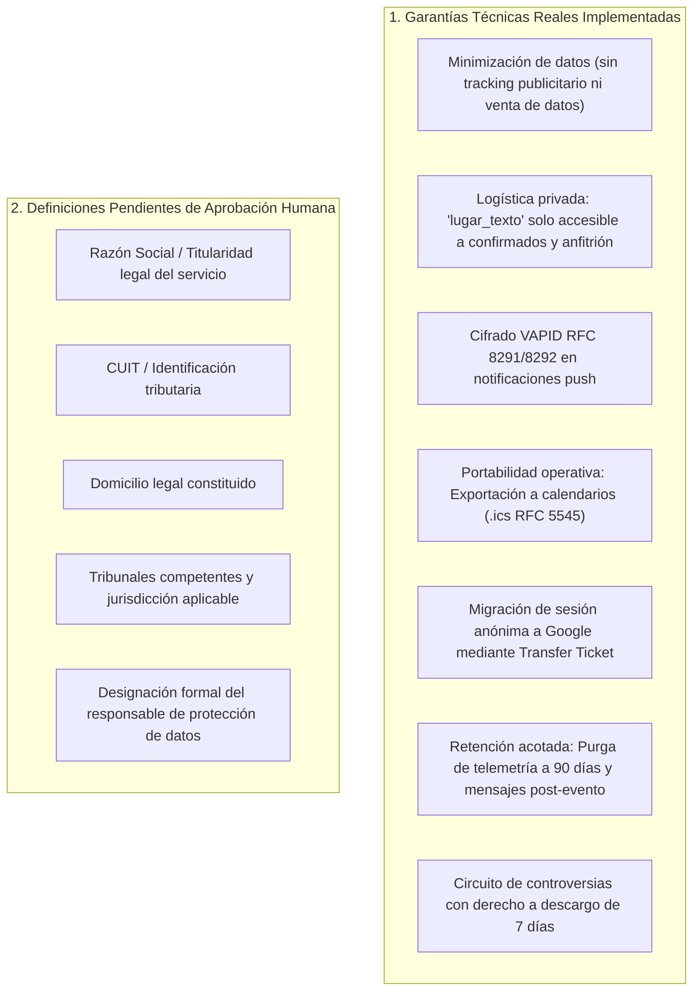

# Propuesta de Páginas y Textos Legales — PuntoEncuentro V1

> **Estado del Documento:** Borrador formal para revisión y validación legal humana.  
> **Alcance:** Preparado para el primer lanzamiento público (V1) en `https://puntoencuentro.com.ar`.  
> **Aviso de Factualidad:** Se ajusta estrictamente a las capacidades reales implementadas en la plataforma, sin atribuir mecanismos automatizados inexistentes de autodestrucción masiva ni exportaciones no soportadas. Los campos que requieren definición jurídica por los responsables están delimitados con `[PENDIENTE REVISIÓN HUMANA]`.

---

## 1. Delimitación: Capa Técnica Real vs. Definición Humana Requerida

Para garantizar total transparencia ante el lanzamiento:

---

## 2. Borrador: Política de Privacidad (Privacy Policy)

**Última actualización:** `[FECHA DE LANZAMIENTO PÚBLICO]`

### 1. Responsable del Tratamiento
El presente servicio digital PuntoEncuentro (en adelante, la "Plataforma") es operado por `[NOMBRE / RAZÓN SOCIAL DEL RESPONSABLE]`, con domicilio en `[DOMICILIO LEGAL / CIUDAD, PROVINCIA, PAÍS]` y correo de contacto oficial `[EMAIL DE CONTACTO OFICIAL]`.

### 2. Datos Personales que Recopilamos y Alcance Real
PuntoEncuentro aplica el principio de **minimización de datos**:
- **Cuentas y Autenticación:** Para usuarios autenticados mediante Google OAuth, recopilamos el identificador de usuario provisto por el proveedor (`sub`), nombre público asociado y correo electrónico. No solicitamos ni almacenamos contraseñas de Google.
- **Participación sin Registro (Invitados Anónimos):** Cuando un usuario participa mediante un enlace privado, se genera un identificador seudónimo local (`token_invitacion` UUID). No se exige registro ni correo electrónico para responder disponibilidad o confirmar asistencia en invitaciones privadas.
- **Datos de Encuentros y Logística:** Título, descripción, fecha, hora y modalidad (presencial o virtual).
  - En encuentros presenciales, la dirección exacta o punto de encuentro (`lugar_texto`) es confidencial: solo se revela a los participantes formalmente confirmados y al anfitrión.
  - En la vista pública comunitaria (Discovery) únicamente se proyecta una zona territorial orientativa aproximada (`open_public_zone`).
- **Notificaciones Web Push:** Para usuarios que activan notificaciones en el navegador o dispositivo móvil, registramos el endpoint público del navegador y las claves criptográficas (`p256dh` y `auth`). Los payloads viajan cifrados de extremo a extremo bajo los estándares IETF RFC 8291 y RFC 8292.
- **Mensajería Interna del Encuentro:** Los mensajes publicados en el panel interno del encuentro son accesibles únicamente a los participantes confirmados y al anfitrión. Se aplica un mecanismo de purga periódica para mensajes de eventos concluidos.
- **Telemetría de Rendimiento:** Eventos de uso disociados y agregados para diagnosticar errores y estabilidad. La telemetría operativa cuenta con una retención máxima de 90 días, tras lo cual es purgada automáticamente por el sistema (`purgar_telemetria_uso_antigua`).

### 3. Finalidad del Tratamiento
Los datos se utilizan exclusivamente para:
1. Facilitar la creación, coordinación, votación de fechas y gestión de cupos en encuentros sociales.
2. Gestionar solicitudes, listas de espera y reconfirmaciones de asistencia.
3. Despachar avisos transaccionales y recordatorios operativos de cambios logísticos o cancelaciones.
4. Prevenir abusos, suplantaciones o conductas inapropiadas mediante herramientas de reporte y bloqueo bilateral.
5. Calcular métricas objetivas y factuales de cumplimiento de asistencia para Encuentros Abiertos (sin scoring subjetivo ni valoraciones discriminatorias).

### 4. Seguridad y Aislamiento de la Información
- La plataforma implementa Seguridad a Nivel de Fila (Row Level Security - RLS) en la base de datos para asegurar que ningún usuario pueda consultar información logística ni de contacto a la que no esté formalmente autorizado.
- Las funciones privilegiadas operan bajo el principio de menor privilegio (`SECURITY DEFINER` con `search_path` aislado).

### 5. Derechos del Usuario (Procedimientos Reales Disponibles)
- **Portabilidad y Exportación:**
  - Los detalles de fecha, horario y enlace de los encuentros pueden ser exportados directamente por el usuario a formatos de calendario interoperables (.ics estándar RFC 5545).
  - La migración de encuentros y asistencias de una sesión anónima a una cuenta permanente se realiza mediante el protocolo Transfer Ticket.
  - Para solicitudes de extracción de datos personales no cubiertas por estas herramientas, el usuario puede solicitarlas por correo a `[EMAIL DE CONTACTO OFICIAL]`.
- **Rectificación:** El usuario puede actualizar su información de perfil y estados de asistencia directamente desde la plataforma.
- **Baja y Supresión de Datos (Derecho al Olvido):**
  - La plataforma no cuenta actualmente con un botón de autoservicio de autodestrucción inmediata de cuenta.
  - La solicitud de baja definitiva de cuenta y supresión de datos personales asociados debe remitirse por correo electrónico a `[EMAIL DE CONTACTO OFICIAL]`.
  - La administración procederá a la desvinculación y eliminación del registro en el sistema de autenticación. En los encuentros donde haya participado, se preservará únicamente la constancia numérica agregada requerida para la integridad factual histórica de las asistencias, disociada de toda identidad personal.

### 6. Jurisdicción y Autoridad de Aplicación
`[DEFINIR SEGÚN PAÍS/JURISDICCIÓN, EJ: En la República Argentina, de conformidad con la Ley N° 25.326 de Protección de los Datos Personales, la Agencia de Acceso a la Información Pública es el órgano de control]`.

---

## 3. Borrador: Términos y Condiciones de Uso

**Última actualización:** `[FECHA DE LANZAMIENTO PÚBLICO]`

### 1. Naturaleza de la Plataforma
PuntoEncuentro es una plataforma tecnológica que facilita herramientas de software para que personas humanas organicen, coordinen y se sumen voluntariamente a encuentros presenciales o virtuales.
**PuntoEncuentro NO organiza, financia, auspicia, supervisa ni garantiza los eventos organizados por los usuarios**, actuando únicamente como canal de intermediación técnica.

### 2. Responsabilidad de los Participantes y Encuentros Presenciales
- **Carácter Voluntario:** La asistencia a cualquier encuentro presencial se realiza bajo la entera y exclusiva responsabilidad y riesgo de cada participante.
- **Seguridad Personal y Sentido Común:** Se exhorta a los usuarios a realizar los encuentros en lugares públicos iluminados, concurridos y seguros, e informar a allegados sobre su participación.
- **Conducta y Convivencia:** Los participantes deben guardar respeto mutuo y abstenerse de cualquier conducta violenta, discriminatoria, acosadora o ilícita.

### 3. Ciclo de Vida del Encuentro, Cupos y Asistencia
- **Compromiso de Asistencia:** En los Encuentros Abiertos, el anfitrión y los participantes asumen el compromiso de asistir puntualmente en la fecha y hora coordinadas.
- **Retiro y Lista de Espera:** Si un participante no puede asistir, debe registrar su retiro voluntario a través de la plataforma para liberar el cupo al siguiente postulante en la lista de espera.
- **Cierre Posterior y Registro de Hechos:** Concluido el evento, el anfitrión asentará el estado de asistencia efectivo de cada participante.
- **Derecho a Descargo y Controversias:** Si un participante fue reportado ausente de forma errónea, cuenta con un plazo perentorio de siete (7) días corridos para solicitar una revisión o descargo. Un equipo de moderación humana revisará las evidencias y rectificará la constancia fáctica si correspondiere.

### 4. Herramientas de Confianza, Bloqueo y Moderación
- **Bloqueo Bilateral:** Todo usuario puede bloquear a otro en cualquier momento. El bloqueo es bilateral e inmediato: impide ver iniciativas mutuas en Discovery, desestima postulaciones cruzadas y suprime notificaciones.
- **Reportes:** Los usuarios pueden reportar encuentros o conductas inapropiadas. PuntoEncuentro se reserva el derecho de cancelar encuentros, revocar cupos o suspender cuentas que infrinjan estos términos.

### 5. Limitación de Responsabilidad
En la máxima medida permitida por las leyes aplicables, `[NOMBRE / RAZÓN SOCIAL DEL RESPONSABLE]` no será responsable por daños indirectos, incidentales, extravíos, perjuicios o desavenencias personales ocurridas antes, durante o después de un encuentro físico entre particulares.

---

## 4. Borrador: Centro de Soporte y Canales Operativos

### Canales Disponibles

1. **Soporte y Feedback In-App:**
   - Accesible directamente desde el menú de la aplicación: botón **"Dar feedback o reportar error"**.
   - Permite clasificar la consulta (problema técnico, sugerencia, consulta de asistencia) y registrarla directamente en el sistema de soporte interno (`user_feedback`).
2. **Contacto Electrónico Oficial:**
   - **Consultas Generales y Soporte Técnico:** `[soporte@puntoencuentro.com.ar]`
   - **Reportes de Seguridad o Abusos:** `[seguridad@puntoencuentro.com.ar]`
   - **Consultas sobre Privacidad, Ejercicio de Derechos y Baja de Cuenta:** `[privacidad@puntoencuentro.com.ar]`
3. **Plazos de Respuesta Estimados:**
   - Reportes de moderación y seguridad urgente: dentro de las 24 horas hábiles.
   - Controversias de asistencia post-evento: dentro de la ventana reglamentaria de 7 días corridos.
   - Consultas generales de soporte operativo: entre 24 y 48 horas hábiles.
