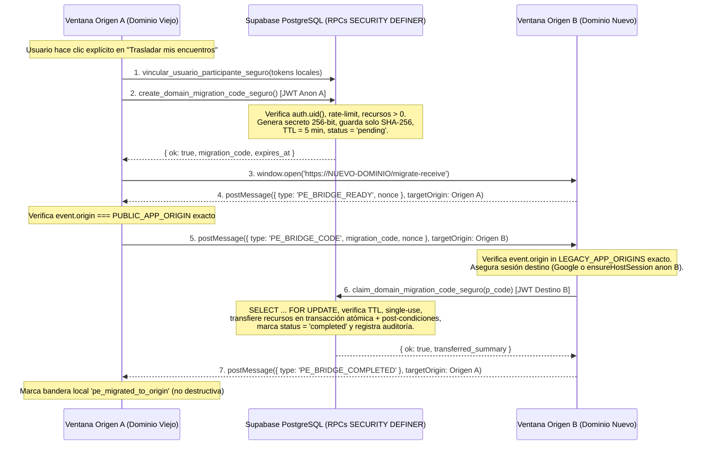

# Diseño de Seguridad: Preservación de Identidad y Puente entre Dominios

**Estado del documento:** Diseño técnico y de seguridad completo, contrastado con las RPCs reales del repositorio.  
**Alcance en esta misión:** Análisis de viabilidad, protocolo criptográfico, modelo de amenazas y plan de pruebas. **No implementado aún en producción ni en base de datos**, conforme a la restricción de requerir revisión específica de seguridad antes de habilitar transferencia *cross-origin*.

---

## 1. Diagnóstico del Modelo de Identidad Actual en PuntoEncuentro

### 1.1 Por qué un cambio de dominio rompe el estado local del navegador
La política *Same-Origin* aísla completamente `localStorage`, `sessionStorage`, IndexedDB, Service Workers y `Notification.permission` por `(scheme, host, port)`. Al pasar de `https://puntoencuentro.com.ar` (Origen A) a `https://<nuevo-dominio>` (Origen B), el navegador abre Origen B sin sesión ni datos locales.

### 1.2 Situación exacta por tipo de usuario

| Cohorte de Usuario | Fuente de Identidad Actual | Efecto al Abrir Origen B | Complejidad de Migración |
| :--- | :--- | :--- | :--- |
| **1. Usuario con cuenta Google** (`is_anonymous = false`) | `auth.users.id` vinculado a identidad OAuth Google en el mismo proyecto Supabase | Sin sesión inicial en Origen B, pero al pulsar «Continuar con Google» obtiene el **mismo `auth.uid()`** y recupera instantáneamente encuentros, participaciones, contactos, plantillas, solicitudes y preferencias en servidor. | **Baja** (solo requiere registrar Origen B en Supabase Auth y Google Cloud OAuth). |
| **2. Usuario anónimo SIN recursos** (`is_anonymous = true`, inventario vacío) | `signInAnonymously()` en Origen A sin filas asociadas | Puede iniciar limpio en Origen B sin riesgo de pérdida; no debe arrastrar estado innecesario. | **Nula** (`get_anonymous_upgrade_state()` devuelve `has_transferable_resources = false`). |
| **3. Usuario anónimo CON recursos** (`is_anonymous = true`) | `auth.uid()` anónimo en `localStorage['sb-*-auth-token']` de Origen A | **CRÍTICO:** Si pierde o abandona Origen A sin transferir, **es imposible volver a autenticarse con ese `auth.uid()` anónimo** desde Origen B. | **Alta** (requiere upgrade previo a Google en Origen A o Puente Seguro Cross-Origin). |
| **4. Invitado solo con tokens locales** (sin sesión o anónimo no vinculado) | `participated_tokens`, `encuentros_general`, `encuentros_coordination_general`, `pe_joined_*` en `localStorage` | El enlace original (`/invite/:token`, `/join/:token`) sigue funcionando en Origen B, pero su bandeja «Mis participaciones» en Home no listará automáticamente esos tokens hasta reabrir el link o rescatarlos. | **Media** (rescatable vinculando tokens a `auth.uid()` con `vincular_usuario_participante_seguro`). |
| **5. Usuario multidispositivo** | Cuenta Google en N dispositivos o sesiones anónimas independientes por dispositivo | Cuentas Google sincronizan automáticamente en cada dispositivo tras login; cada dispositivo anónimo con recursos propios debe ejecutar su rescate individualmente. | **Media** (el puente debe permitir múltiples canjes independientes de distintas fuentes anónimas hacia una misma cuenta permanente). |

---

## 2. Evaluación de Viabilidad de las RPCs Reales Existentes

Se auditaron las migraciones `20260713145000_harden_host_auth_and_data_access.sql`, `20260928180000_anonymous_account_transfer.sql`, `20260928190000_revoke_my_pending_transfer_ticket.sql`, `20261020100000_encounter_messages_panel_v1.sql` y `20261020183000_confirmar_transferencia_anonima_completada.sql`.

### 2.1 Componentes 100% reutilizables hoy
1. **`public.anonymous_transfer_tickets`:**
   - Almacena exclusivamente `token_hash` (`SHA-256` de 64 hex chars, nunca el token en claro).
   - Genera entropía criptográfica real de 256 bits (`extensions.gen_random_bytes(32)`).
   - Índice único parcial `idx_anonymous_transfer_single_pending` que impide emitir múltiples tickets pendientes concurrentes por `source_user_id_snapshot` + `pg_advisory_xact_lock`.
   - TTL corto (`15 minutes`), bloqueo pesimista `FOR UPDATE` al canjear y auditoría en `resources_transferred` JSONB.
2. **`public.get_anonymous_upgrade_state()`:**
   - Evalúa server-side (`auth.uid()`) si el usuario anónimo posee recursos transferibles.
3. **`public.create_anonymous_transfer_ticket()` y `public.revoke_my_pending_transfer_ticket()`:**
   - Exigen prueba criptográfica de posesión de la sesión original mediante el JWT activo de Supabase (`auth.uid()` + `is_anonymous = true`).
4. **`public.claim_anonymous_transfer(p_transfer_token)` y `public.confirmar_transferencia_anonima_completada_seguro(p_transfer_token)`:**
   - Transfieren atómicamente con verificación de post-condiciones estrictas:
     - `public.encuentros` (`host_id`)
     - `public.usuario_localidades` (`user_id`)
     - `public.participantes` (`user_id`, canonizando conflictos)
     - `public.solicitudes_encuentro_abierto` (`usuario_id`, respetando índices únicos)
     - `public.custom_invitation_templates` (`user_id`, con bypass transaccional de cuota)
     - `public.ai_creation_sessions` (`user_id`)
     - `public.creation_sessions` (`user_id`)

### 2.2 Limitaciones detectadas frente a una migración entre dominios
1. **Transporte local en `sessionStorage` no cruza orígenes:**  
   Hoy `AuthContext.tsx` guarda `pe_pending_transfer_ticket` en `sessionStorage` para sobrevivir al redirect OAuth dentro del **mismo origen**. Si el usuario salta de Origen A a Origen B, `sessionStorage` en Origen B está vacío.
2. **Restricción `permanent_account_required` en el destino (`claim_anonymous_transfer`, línea 316):**  
   `claim_anonymous_transfer` rechaza explícitamente que `v_target_user_id` sea otra sesión anónima (`IF v_is_anon THEN RETURN {'ok': false, 'error': 'permanent_account_required'}`).
   - **Implicancia de producto y seguridad:** Si el usuario se autentica con Google en Origen A antes de ir a Origen B (o canjea en Origen B tras iniciar sesión con Google), la RPC actual funciona. Si en cambio se desea permitir que un usuario anónimo en Origen A continúe siendo **anónimo** en Origen B conservando sus encuentros, se requiere una RPC aditiva controlada (`claim_cross_origin_anonymous_migration_seguro`) o exigir vinculación Google como requisito de traslado seguro.
3. **Brecha menor de cobertura en tablas posteriores a sep-2026:**  
   - `public.encuentro_mensajes` (`20261020100000`): un organizador o participante anónimo pudo publicar mensajes con `autor_user_id = v_source_user_id` o `destacado_por = v_source_user_id`. Conviene añadir en una migración aditiva previa al corte:
     ```sql
     UPDATE public.encuentro_mensajes SET autor_user_id = v_target_user_id WHERE autor_user_id = v_source_user_id;
     UPDATE public.encuentro_mensajes SET destacado_por = v_target_user_id WHERE destacado_por = v_source_user_id;
     ```
   - Tokens locales de invitados no enlazados (`participated_tokens`, `encuentros_general`): si el invitado nunca llamó a `vincular_usuario_participante_seguro`, `participantes.user_id` sigue `NULL`. Antes de emitir el ticket en Origen A, el cliente puede invocar `vincular_usuario_participante_seguro(token)` por cada token local válido mientras posee sesión en Origen A, quedando automáticamente cubiertos en `public.participantes`!

---

## 3. Diseño del Puente Seguro entre Dominio Antiguo (Origen A) y Dominio Nuevo (Origen B)

### 3.1 Invariantes de Seguridad No Negociables
- **PROHIBIDO** enviar `access_token`, `refresh_token` o sesiones JWT de Supabase en URLs, query params, fragmentos `#`, `window.name` ni `localStorage` compartido por iframes inseguros.
- **PROHIBIDO** enviar el `ticket_token` de 256 bits en query strings (`?ticket=...`), ya que quedaría expuesto en historiales de navegación, encabezados `Referer`, proxies corporativos y logs de acceso CDN.
- **PROHIBIDO** aceptar `source_user_id` como parámetro del cliente: solo `auth.uid()` del JWT verificado por Supabase en Origen A puede originar un código de migración.

### 3.2 Camino Primario Recomendado (Mínima Superficie de Ataque — Cero Transporte Cross-Origin)
Para la mayoría de usuarios en Origen A durante la ventana de transición:
1. En el banner «Nos mudamos a `<NuevoDominio>`» mostrado en Origen A:
   - Si el usuario ya es permanente (Google): botón directo **«Abrir `<NuevoDominio>` e iniciar sesión con Google»**. No hay secreto que transportar; al autenticarse con Google en Origen B recupera el 100% de sus recursos.
   - Si el usuario es anónimo con recursos (o tokens locales en `localStorage`):
     1. Pre-vincular silenciosamente sus `getAllParticipatedTokens()` locales a su sesión anónima actual mediante `vincular_usuario_participante_seguro`.
     2. Invitarlo a pulsar **«Guardar mis encuentros con Google y pasar al nuevo sitio»** **dentro del mismo Origen A** (usando el flujo ya probado y auditado de `create_anonymous_transfer_ticket` + Google OAuth *same-origin* + `claim_anonymous_transfer`).
     3. Una vez completado el claim en Origen A, redirigirlo a Origen B donde un clic en «Continuar con Google» abre exactamente la misma cuenta con cero riesgo *cross-origin*.

### 3.3 Camino Secundario: Puente Cross-Origin para Anónimos que NO desean vincular Google (o Rescate Directo A → B)

Si producto decide soportar traslado **Anónimo (Origen A) → Anónimo o Permanente (Origen B)** sin pasar por Google en Origen A:



#### Fallback Manual Seguro (Navegadores in-app o bloqueo de `window.opener`)
Si `window.opener` es `null` (ej. WebViews estrictos o el usuario copia la URL manualmente):
- Origen A muestra un **código efímero de un solo uso** (agrupado visualmente para copia al portapapeles, vigencia 5 minutos, nunca en URL) con botón «Copiar código de rescate y abrir nuevo sitio».
- En `https://<nuevo-dominio>/migrate-receive`, el usuario pega el código en un `<input type="password" autocomplete="one-time-code">`, enviándose exclusivamente en el cuerpo POST JSON de `supabase.rpc(...)` sobre TLS.

---

## 4. Controles de Seguridad, Amenazas y Mitigaciones

| Amenaza | Vector de Ataque | Control Obligatorio en el Diseño |
| :--- | :--- | :--- |
| **Exposición de credenciales / sesiones** | Pasar `access_token` o `ticket` en `?token=...` o `#hash` | Prohibido por diseño; transporte exclusivo por `postMessage` con orígenes exactos o input POST de un solo uso. |
| **Replay / Doble canje concurrente** | Dos clientes intentando canjear el mismo código en paralelo | `SELECT ... FROM ... WHERE token_hash = sha256(code) FOR UPDATE`, verificación `status = 'pending' AND used_at IS NULL`, e invalidación inmediata en la misma transacción. |
| **Fuerza bruta / Adivinación de código** | Enumerar códigos contra la RPC de canje | Secreto de 256 bits (`gen_random_bytes(32)`) + TTL de 5 minutos + `check_and_increment_rate_limit` por `auth.uid()` destino (máx. 5 intentos / 15 min, fail-closed). |
| **Robo por `postMessage` malicioso** | Sitio atacante abre ventana o escucha `message` con `targetOrigin: '*'` | Prohibido `'*'`. Origen A solo envía a `PUBLIC_APP_ORIGIN` exacto tras recibir `PE_BRIDGE_READY`; Origen B solo acepta `event.origin` presente en `LEGACY_APP_ORIGINS` exactos. |
| **CSRF / Ejecución sin consentimiento** | Trigger silencioso al cargar iframe oculto | `X-Frame-Options: DENY` / `frame-ancestors 'none'` en rutas `/auth/domain-bridge` y `/migrate-receive` + botón explícito requerido del usuario. |
| **Suplantación entre cuentas (Cross-Account)** | Usuario permanente intenta absorber recursos de otra cuenta permanente | La emisión exige estrictamente `(auth.jwt() ->> 'is_anonymous')::boolean = true` y verifica en el momento del canje que `source_user_id` siga siendo `is_anonymous = true` en `auth.users`. |
| **Cancelación o caída de red a mitad del flujo** | Se cierra la pestaña antes del paso 6 o se pierde la respuesta HTTP | Origen A **no hace `signOut()`** ni borra `localStorage`: si el usuario cancela o el código expira (5 min), sus recursos siguen intactos en Origen A y puede revocar/emitir un nuevo código (`revoke_my_pending_transfer_ticket`) o verificar idempotencia (`confirmar_transferencia_anonima_completada_seguro`). |
| **Open Redirect post-rescate** | Parámetro `?next=https://evil.com` en la ruta del puente | Reutilizar estrictamente `isValidPostAuthRedirect(nextPath)` (`src/hooks/usePostAuthRedirect.ts`). |

---

## 5. Plan de Pruebas Obligatorias antes de Habilitar el Puente (Próximo Mini-Sprint)

1. **Prueba positiva Anónimo → Google (Camino Primario):** Crear encuentro fijo, plantilla custom, localidad y token de participante en sesión anónima; ejecutar upgrade y verificar lectura en sesión limpia simulando Origen B.
2. **Prueba positiva Anónimo A → Anónimo B (si se habilita Camino Secundario):** Verificar transferencia atómica incluyendo `encuentro_mensajes.autor_user_id` y post-condiciones en cero para `source_user_id`.
3. **Prueba adversarial de concurrencia (`Promise.all`):** Dos sesiones destino intentando canjear simultáneamente el mismo código → exactamente 1 retorna `ok: true` y la otra retorna `ticket_already_used`.
4. **Prueba adversarial de expiración y revocación:** Código con `expires_at < now()` o revocado retorna rechazo terminal sin mutar filas.
5. **Prueba adversarial de `postMessage`:** Mensajes desde `https://evil.com` o `https://puntoencuentro.com.ar.evil.com` son descartados sin exponer ni aceptar códigos.
6. **Prueba de recuperación ante cancelación:** Emitir código en Origen A, cerrar Origen B sin canjear, comprobar que Origen A sigue administrando sus encuentros sin pérdida de titularidad.
