# Auditoría de Seguridad y Diseño Definitivo del Puente de Identidad entre Dominios (Mini-Sprint 2A)

**Estado del documento:** Diseño definitivo auditado contra el esquema SQL real (`supabase/migrations/`) y el código frontend vigente (`src/`, `api/`, `public/sw.js`) en la rama `staging` (post-PR #2, commit `91606591`).  
**Alcance en Mini-Sprint 2A:** Auditoría técnica y diseño de seguridad únicamente. **Sin migraciones ejecutadas ni cambios en Supabase, Vercel, DNS u OAuth.**  
**Documentos complementarios (sin duplicación):**
- Recorridos de usuario, estados de pantalla y mensajes: [`RECORRIDOS_UX_RECUPERACION_DOMINIO.md`](./RECORRIDOS_UX_RECUPERACION_DOMINIO.md)
- Matriz de pruebas adversariales y plan ejecutable del Mini-Sprint 2B: [`PLAN_MINI_SPRINT_2B_PUENTE_IDENTIDAD.md`](./PLAN_MINI_SPRINT_2B_PUENTE_IDENTIDAD.md)
- Topología de dominios, enlaces, PWA y Web Push: [`ARQUITECTURA_DOMINIOS.md`](./ARQUITECTURA_DOMINIOS.md)

---

## 1. Auditoría del Modelo de Identidad, Almacenamiento y Sesiones Actual (Trabajo A)

### 1.1 Modelo de identidad en Supabase y aislamiento Same-Origin
La aplicación utiliza un único proyecto Supabase por entorno (`wougfhfwqgmxhgvjqoua` en Staging; `aurbicjwftjhwryhyjiq` en Producción). La política *Same-Origin* del navegador aísla estrictamente `localStorage`, `sessionStorage`, IndexedDB, Service Workers y `Notification.permission` por tupla `(scheme, host, port)`. Al cambiar de `Dominio A` a `Dominio B` (y en el futuro a `Dominio C`), la base de datos PostgreSQL es la misma, pero el navegador abre el nuevo dominio sin sesión ni almacenamiento local.

En el código actual conviven **tres modos de identidad**:

| Modo de Identidad | Cómo nace en el código actual | Representación en Supabase / PostgreSQL | Efecto directo al abrir `Dominio B` |
| :--- | :--- | :--- | :--- |
| **1. Cuenta permanente (Google OAuth)** | `signInWithGoogle()` en `src/lib/auth.ts` (`supabase.auth.signInWithOAuth({ provider: 'google' })`). | `auth.users.id` estable, rol `authenticated`, claim JWT `is_anonymous = false`, identidad vinculada en `auth.identities`. | Al iniciar sesión con Google en `Dominio B`, Supabase emite sesión para el **mismo `auth.uid()`** sin pérdida ni duplicación de recursos en servidor. |
| **2. Sesión anónima autenticada** | `ensureHostSession()` en `src/lib/ensureHostSession.ts` (`supabase.auth.signInAnonymously({ options: { captchaToken } })`) al crear encuentro fijo, guardar zonas, pedir cobertura o pasar de invitado a anfitrión (`GuestToHostCard.tsx`). | `auth.users.id` aleatorio irrepetible, rol `authenticated`, claim JWT `is_anonymous = true`. Persistida solo en `localStorage['sb-<project-ref>-auth-token']` de `Dominio A`. | **Riesgo crítico:** `Dominio B` no puede leer `localStorage` de `Dominio A` ni volver a autenticarse como ese `auth.uid()` anónimo. Sin puente o upgrade previo, el organizador pierde la titularidad (`host_id`). |
| **3. Invitado sin sesión (`user === null`)** | Abrir `/invite/:token`, `/join/:public_token`, `/coordination/join/:token` o `/coordination/invite/:token`. Opera mediante RPCs `SECURITY DEFINER` autenticadas por token de capacidad (`token_invitacion` / `public_token`). | Sin fila en `auth.users`; fila en `public.participantes` con `user_id IS NULL` y `token_invitacion UUID NOT NULL`. | Los enlaces individuales o generales siguen funcionando en `Dominio B`, pero la bandeja «Participo» en `Home` queda vacía porque los tokens residían en `localStorage` de `Dominio A`. |

> **Nota sobre creación sin registro vs. funcionalidades que exigen cuenta permanente:**  
> - **Permiten sesión anónima (`is_anonymous = true`):** `crear_encuentro_seguro` (encuentros privados de fecha fija), diseños personalizados (`custom_invitation_templates`), mensajes en encuentro (`mensajes_encuentro`), contacto opcional de WhatsApp del anfitrión (`encuentros_contacto_whatsapp`), preferencias zonales (`usuario_localidades`), solicitudes de cobertura (`coverage_requests`), feedback (`user_feedback`) y telemetría QA (`creation_sessions`).  
> - **Exigen cuenta permanente (`is_anonymous = false` server-side):** `crear_encuentro_con_opciones_seguro` (`20261019180000`, línea 85), apertura de encuentros abiertos y solicitudes (`20260928150000`), asistente IA (`check_and_reserve_ai_session`), intenciones/alertas (`20260929170000`), bloqueos (`20260930160000`), contactos frecuentes, listas reutilizables, plantillas favoritas, invitaciones internas y suscripciones Web Push (`20261003120000`).

### 1.2 Auditoría de RPCs de transferencia existentes y código muerto
Se contrastaron las migraciones `20260713145000_harden_host_auth_and_data_access.sql`, `20260928180000_anonymous_account_transfer.sql`, `20260928190000_revoke_my_pending_transfer_ticket.sql` y `20261020183000_confirmar_transferencia_anonima_completada.sql`:

1. **Infraestructura sólida reutilizable:**
   - `public.anonymous_transfer_tickets` almacena únicamente `token_hash` (`SHA-256` hex de 64 caracteres sobre 32 bytes CSPRNG `extensions.gen_random_bytes(32)`), snapshots inmutables (`source_user_id_snapshot`, `target_user_id_snapshot`), índice único parcial `idx_anonymous_transfer_single_pending` (`WHERE status = 'pending'`) y `RLS` activado con `REVOKE ALL FROM PUBLIC, anon, authenticated`.
   - `create_anonymous_transfer_ticket()` serializa por emisor con `pg_advisory_xact_lock`, verifica posesión de sesión (`auth.uid()` + `is_anonymous = true`) y exige recursos transferibles reales.
   - `claim_anonymous_transfer(p_transfer_token)` bloquea el ticket con `SELECT ... FOR UPDATE`, ejecuta transferencia transaccional y valida post-condiciones estrictas con `RAISE EXCEPTION` si quedara algún recurso huérfano.
   - `confirmar_transferencia_anonima_completada_seguro(p_transfer_token)` resuelve la caída de red post-commit verificando `status = 'completed'` e identidad exacta del destinatario sin filtrar estado a terceros.
   - `revoke_my_pending_transfer_ticket()` permite invalidar un ticket pendiente propio.
   - `vincular_usuario_participante_seguro(p_token)` asocia `participantes.user_id = auth.uid()` cuando `user_id IS NULL` y es ejecutable por sesiones tanto permanentes como anónimas (`GRANT EXECUTE TO authenticated`).

2. **Incompatibilidades actuales para cambio de dominio y brechas reales en código:**
   - **Bloqueo de destino anónimo:** Tanto `claim_anonymous_transfer` (`20260928180000`, línea 316) como `confirmar_transferencia_anonima_completada_seguro` (`20261020183000`, línea 30) retornan `'permanent_account_required'` si el destinatario tiene `is_anonymous = true`. Esto impide la Estrategia 2 (`Anónimo A → Anónimo B`).
   - **Sin rate-limit server-side dedicado en emisión/canje de tickets:** Aunque el token tiene 256 bits de entropía, `claim_anonymous_transfer` y `create_anonymous_transfer_ticket` no invocan aún `check_rate_limit_internal`.
   - **Omisión de `AuthContext.tsx` para sesiones anónimas:** En `src/contexts/AuthContext.tsx` (línea 355), `onAuthStateChange` retorna temprano si `newUser.is_anonymous` es verdadero, por lo que nunca ejecuta reclamo ni revinculación para un destino anónimo.
   - **Código muerto residual detectado:** `encuentrosService.linkAnonymousEncuentros` (`src/services/encuentrosService.ts`, líneas 652–664) invoca `transferir_encuentros_anonimos_seguro`, RPC eliminada por seguridad en `20260713145000` (línea 612). Debe limpiarse en 2B para evitar confusiones.
   - **Detalle menor en `vincular_usuario_participante_seguro`:** No impide que un anfitrión vincule accidentalmente un `token_invitacion` de su propio encuentro (`encuentros.host_id = auth.uid()`). Aunque `claim_anonymous_transfer` limpia esa colisión, el vinculador por lote de 2B debe ignorar tokens cuyo encuentro ya pertenezca a `auth.uid()`.

### 1.3 Dependencias de `localStorage` y `sessionStorage` (Brechas Reales Detectadas)

| Almacén y Clave Real en Código | Archivo Productor / Consumidor | Contenido y Rol | Hallazgo de Auditoría ante Migración `A → B` |
| :--- | :--- | :--- | :--- |
| `localStorage['sb-<ref>-auth-token']` | `src/lib/supabase.ts` (`supabase-js`) | `access_token`, `refresh_token`, `user` | **Secreto de sesión.** Prohibido transportarlo entre dominios. |
| `localStorage['sb-<ref>-auth-token-code-verifier']` | `supabase-js` (PKCE OAuth) | Verificador efímero durante handshake OAuth | Atado al origen que inició el login; por eso `resolveLegacyDomainRedirect` exime `?code=`, `?error_description=`, `#access_token=`. |
| `localStorage['participated_tokens']` | `src/lib/participatedTokens.ts`, `InviteGuest.tsx` | Array JSON de `token_invitacion` individuales (fecha fija) | Leído por `getAllParticipatedTokens()`. Debe pre-vincularse a `auth.uid()` en `Dominio A` antes de migrar. |
| `localStorage['puntoencuentro_guest_token_by_public_<pub>']` | `src/screens/JoinGeneral.tsx` (línea 356) | `token_invitacion` obtenido vía link general fijo | **BRECHA CRÍTICA #1:** `getAllParticipatedTokens()` **NO lee este prefijo** (solo lee `participated_tokens` y el legado `encuentros_general` retirado en `src/main.tsx`). Hoy estos invitados no aparecen ni se rescatarían. |
| `localStorage['puntoencuentro_coordination_guest_token_by_public_<pub>']` | `src/screens/JoinCoordination/index.tsx` (línea 264) | `token_invitacion` obtenido vía link general de coordinación | **BRECHA CRÍTICA #2:** Tampoco es leído por `getAllParticipatedTokens()`, ni `JoinCoordination` llama a `saveParticipatedToken` ni a `linkParticipantTokenToCurrentUser`. |
| *(Ausencia de guardado en `/coordination/invite/:token`)* | `src/screens/InviteCoordination/index.tsx` | Invitación individual de coordinación | **BRECHA CRÍTICA #3:** `InviteCoordination` nunca llama a `saveParticipatedToken(token)` ni a `linkParticipantTokenToCurrentUser(token)`. Si el invitado responde disponibilidad y cierra la pestaña, ni siquiera queda listado localmente. |
| *(Filtro `if (!user.is_anonymous)` en Home)* | `src/screens/Home.tsx` (línea 1130) | Carga de `get_encuentros_participados_seguro()` | **BRECHA CRÍTICA #4:** En SQL (`20261022213000`, línea 730) la RPC funciona para cualquier `auth.uid()` (incluido anónimo), pero `Home.tsx` la omite si `user.is_anonymous === true`. Sin corregir esta línea en 2B, un usuario `Anónimo B` no vería sus participaciones transferidas en `Dominio B`. |
| `localStorage['encuentros_general']` / `['encuentros_coordination_general']` | `src/main.tsx` (migración legacy), `participatedTokens.ts` | Mapas históricos `{ [encuentroId]: token }` | El colector de rescate en `Dominio A` debe inspeccionarlos de forma defensiva por si un usuario antiguo no recargó tras el cambio. |
| `localStorage['puntoencuentro_zones_v1']` | `src/services/userPreferencesService.ts` | Caché local de macrozonas seleccionadas | Antes de emitir un código de migración en `Dominio A`, si existen zonas locales no sincronizadas, sincronizar con `guardar_localidades_usuario`. |
| `localStorage['puntoencuentro_host_alias']` | `src/lib/hostAliasStorage.ts` | Alias visible sugerido al crear encuentro | Cosmético (no autoriza nada). No requiere transferencia criptográfica; puede reingresarse. |
| `localStorage['puntoencuentro_host_id']` / `['puntoencuentro_meet_hosts']` | `src/lib/meetHostsStorage.ts` | Fallbacks locales de UI de anfitrión | La autorización real en backend usa `encuentros.host_id = auth.uid()`. En `Dominio B`, `Home.tsx` reconstruye `rememberEncuentroHostBulk(sortedOrganized)` automáticamente desde servidor. |
| `localStorage['pe_encounter_draft_v1']` | `src/lib/encounterDraft.ts` | Borrador no publicado del wizard de creación | Efímero. Si existe borrador sin guardar en `Dominio A`, advertir al usuario antes de saltar o descartar sin riesgo de pérdida de encuentros reales. |
| `localStorage['pe_app_usage_client_token_v1']` | `src/services/appUsageTelemetry.ts` | UUID anónimo hasheado para telemetría agregada | Se regenera limpio en `Dominio B` (privacidad por diseño, cero impacto funcional). |
| `sessionStorage['pe_pending_transfer_ticket']` | `src/contexts/AuthContext.tsx` | Ticket pendiente durante OAuth same-origin | Solo vive en la pestaña del mismo origen; inservible entre `Dominio A` y `Dominio B`. |
| `sessionStorage['pending_participant_invitation_token']` | `InviteGuest.tsx`, `JoinGeneral.tsx`, `AuthContext.tsx` | Último token de invitado visto en la pestaña | Incluirlo en el barrido previo al rescate en `Dominio A`. |
| `sessionStorage['pe_post_auth_redirect']` | `src/hooks/usePostAuthRedirect.ts` | Ruta interna segura post-login | `STATIC_ALLOWED_POST_AUTH_ROUTES` en `usePostAuthRedirect.ts` debe ampliarse en 2B para admitir `/migrate-receive` y `/auth/domain-bridge`. |

### 1.4 Compatibilidad de tokens de invitación, OAuth, PWA y Web Push
- **Tokens de invitación y participación:** `encuentros.public_token`, `participantes.token_invitacion` e `invitaciones_internas.id` son UUIDs independientes del dominio DNS (`ARQUITECTURA_DOMINIOS.md`, §3). Cualquier enlace reescrito de `Dominio A` a `Dominio B` conserva validez inmediata.
- **OAuth Google (Implicit / PKCE):** `src/lib/supabase.ts` instancia `createClient(supabaseUrl, supabaseKey)` con configuración estándar de `supabase-js` v2 y `signInWithGoogle` fija `redirectTo: ${window.location.origin}${safeRedirectPath}`. Mientras ambos orígenes estén registrados en *Redirect URLs* de Supabase Auth y *Authorized JavaScript origins* de Google Cloud Console, el login funciona en ambos sin interferencia. Nunca debe redirigirse una URL con `?code=`, `?error_description=` o `#access_token=` entre dominios (`resolveLegacyDomainRedirect` ya protege esta invariante).
- **Service Worker (`public/sw.js`) y Web Push (`src/services/webPushService.ts`):**
  - `public/sw.js` no intercepta `fetch` ni cachea documentos/assets; limpia cachés heredadas en `activate` y al hacer clic en una notificación abre exclusivamente `new URL('/?notifications=1', self.location.origin).href`.
  - `registrar_web_push_subscription_seguro` (`20261003120000`) rechaza usuarios anónimos (`anonymous_not_allowed`). Por lo tanto, **ningún usuario anónimo tiene suscripciones Web Push que migrar**.
  - Para usuarios permanentes (Google), las suscripciones en `public.web_push_subscriptions` siguen siendo válidas porque el par VAPID identifica al servidor de aplicación y no depende del dominio DNS, pero en `Dominio B` el permiso `Notification.permission` parte en `'default'`. Al reactivar avisos en `Dominio B`, debe revocarse el endpoint del navegador viejo (o desactivar avisos en `Dominio A`) para evitar notificaciones duplicadas en el mismo dispositivo.

---

## 2. Inventario Exhaustivo de Recursos por Usuario y Anfitrión en PostgreSQL (Trabajo B)

Se auditaron las **126 migraciones SQL** del repositorio buscando todas las claves foráneas `REFERENCES auth.users(id)`, columnas `host_id` / `user_id` / `usuario_id` / `autor_*` y políticas RLS.

### 2.1 Corrección Documental Importante: `public.mensajes_encuentro` (no `encuentro_mensajes`)
Los documentos preliminares de la Etapa 1 mencionaban `public.encuentro_mensajes`. En el esquema real (`20261020100000_encounter_messages_panel_v1.sql`, línea 14 y `20261020120000_fix_encounter_messages_panel_hardening.sql`), la tabla real es **`public.mensajes_encuentro`**, con la siguiente estructura de identidad y permisos:

- **Columnas de identidad:**
  - `encuentro_id UUID NOT NULL REFERENCES public.encuentros(id) ON DELETE CASCADE`
  - `autor_user_id UUID NULL REFERENCES auth.users(id) ON DELETE SET NULL`
  - `autor_participante_id UUID NULL REFERENCES public.participantes(id) ON DELETE SET NULL`
  - `es_organizador BOOLEAN NOT NULL DEFAULT false`
  - `destacado BOOLEAN NOT NULL DEFAULT false`
  - `destacado_por UUID NULL REFERENCES auth.users(id) ON DELETE SET NULL`
- **Claves únicas:** Solo `id PRIMARY KEY`. **Cero conflictos `UNIQUE`** al reasignar `autor_user_id`, `autor_participante_id` o `destacado_por`.
- **Modelo RLS y privilegios:** `ALTER TABLE public.mensajes_encuentro ENABLE ROW LEVEL SECURITY` + `REVOKE ALL ON TABLE public.mensajes_encuentro FROM PUBLIC, anon, authenticated`. Ningún cliente consulta ni edita la tabla directamente; el 100% del acceso ocurre mediante RPCs `SECURITY DEFINER` (`listar_mensajes_encuentro_seguro`, `publicar_mensaje_encuentro_seguro`, `destacar_mensaje_encuentro_seguro`, `eliminar_mensaje_encuentro_seguro`) que delegan autorización a `public.resolver_actor_encuentro(p_encuentro_id, p_token_invitacion)`:
  - El organizador es autorizado por `v_encuentro.host_id = auth.uid()`.
  - El participante autenticado es autorizado por `participantes.user_id = auth.uid() AND estado <> 'rechazado'`.
  - La autoría propia (`es_mio` y permiso para eliminar mensaje propio en `eliminar_mensaje_encuentro_seguro`) compara `(m.autor_user_id = v_actor.actor_user_id)` o `(m.autor_participante_id = v_actor.participante_id)`.
- **Trampa sutil de cascada (`ON DELETE SET NULL`) detectada en la auditoría:**
  - Cuando el motor de transferencia consolida dos filas duplicadas de `public.participantes` en un encuentro externo (`DELETE FROM public.participantes WHERE encuentro_id = v_enc_id AND id <> v_canonical_part_id`), la FK `autor_participante_id REFERENCES public.participantes(id) ON DELETE SET NULL` **borra `autor_participante_id` (`NULL`)** de los mensajes publicados por la fila eliminada.
  - **Regla obligatoria en la transferencia:**
    1. **Antes** de ejecutar `DELETE FROM public.participantes` de filas redundantes en `v_affected_external_enc_ids`, ejecutar:
       ```sql
       UPDATE public.mensajes_encuentro
       SET autor_participante_id = v_canonical_part_id,
           autor_user_id = v_target_user_id
       WHERE encuentro_id = v_enc_id
         AND autor_participante_id IN (
             SELECT id FROM public.participantes
             WHERE encuentro_id = v_enc_id
               AND user_id IN (v_source_user_id, v_target_user_id)
               AND id <> v_canonical_part_id
         );
       ```
    2. En encuentros propios transferidos (`v_source_owned_enc_ids`), si `v_target_user_id` tenía una participación previa eliminada al convertirse en anfitrión, sus mensajes previos conservan `autor_user_id = v_target_user_id` y `es_organizador = false` (reflejando fielmente que fueron escritos antes de asumir rol de anfitrión), mientras que los mensajes publicados por `v_source_user_id` pasan a `autor_user_id = v_target_user_id` conservando `es_organizador = true`.
    3. Finalmente, actualizar globalmente:
       - `UPDATE public.mensajes_encuentro SET autor_user_id = v_target_user_id WHERE autor_user_id = v_source_user_id;`
       - `UPDATE public.mensajes_encuentro SET destacado_por = v_target_user_id WHERE destacado_por = v_source_user_id;`

### 2.2 Matriz Completa de Entidades y Reglas de Transferencia

#### A. Entidades alcanzables por sesiones anónimas o invitados rescatados (DEBEN procesarse en la transferencia)

| Tabla (`public.*`) | Columnas de Usuario / Host | Restricciones `UNIQUE` / FK críticas | Estado actual en `claim_anonymous_transfer` | Acción obligatoria en el motor unificado (2B) |
| :--- | :--- | :--- | :--- | :--- |
| **`encuentros`** | `host_id` (`NOT NULL`), `cancelled_by` (`NULL`) | PK `id`. Host no puede ser simultáneamente participante en el mismo encuentro. | Transfiere `host_id`. No toca `cancelled_by`. | **Transferir** `host_id = v_target_user_id` (retirando antes solicitudes/participaciones previas del `target` en esos encuentros). Actualizar también `cancelled_by = v_target_user_id WHERE cancelled_by = v_source_user_id` para coherencia histórica del propio organizador. |
| **`encuentros_contacto_whatsapp`** | `host_id` (`UUID NOT NULL`, sin FK a `auth.users`) | PK `encuentro_id` (`REFERENCES encuentros(id) ON DELETE CASCADE`). | **FALTANTE HOY** (creada en `20261021180000`). | **Transferir** `SET host_id = v_target_user_id WHERE host_id = v_source_user_id OR encuentro_id = ANY(v_source_owned_enc_ids)`. Incluir en `get_anonymous_upgrade_state` y post-condición. |
| **`participantes`** | `user_id` (`UUID NULL REFERENCES auth.users ON DELETE SET NULL`) | PK `id`, `UNIQUE(token_invitacion)`, `UNIQUE(encuentro_id, id)`. | Canoniza 1 fila por encuentro externo, pero pierde votos de disponibilidad, disputas y estados recientes si estaban en la fila no canónica. | **Fusionar / Canonizar sin pérdida** según las reglas deterministas de §2.3.2 antes de borrar redundantes. |
| **`participante_disponibilidades`** | Vía `participante_id` (`ON DELETE CASCADE`) | `UNIQUE(participante_id, opcion_fecha_id)` + índice único parcial `idx_unica_preferida_por_participante` (`WHERE es_preferida = true`) + `check_preferida_no_unavailable`. | **BRECHA DE CASCADA HOY:** borrar el participante no canónico elimina sus votos en cascada. | **Fusionar boletas antes del `DELETE` de `participantes`** con desempate por `MAX(updated_at)` y relleno de opciones faltantes (§2.3.3). |
| **`mensajes_encuentro`** | `autor_user_id`, `autor_participante_id`, `destacado_por` | Sin `UNIQUE` secundarios. `ON DELETE SET NULL` en `autor_participante_id`. | **FALTANTE HOY** (creada en `20261020100000`). | **Re-vincular y transferir sin borrar ningún mensaje** (§2.1 y §2.3.4). Incluir en `get_anonymous_upgrade_state` y post-condiciones. |
| **`solicitudes_encuentro_abierto`** | `usuario_id` (`NOT NULL REFERENCES auth.users ON DELETE CASCADE`) | Índice único parcial `idx_solicitudes_activas_unicas` en `(encuentro_id, usuario_id) WHERE estado IN ('pending', 'approved', 'waitlist_waiting', 'waitlist_offered', 'waitlist_confirmed')` (`20261024220000`). | Deduplica, pero el `CASE estado` desconoce los estados `waitlist_*` (les asigna prioridad `0`, menor que `rejected`). | **Canonizar con jerarquía completa de 9 estados** preservando cola FIFO, plazos de oferta/aprobación y mensaje (§2.3.5). |
| **`asistencia_controversias`** | `involucrado_id`, `iniciado_por`, `participante_id` (`ON DELETE CASCADE`) | `uq_controversia_asistencia_participante` (`encuentro_id, participante_id, tipo_controversia`) y `uq_controversia_realizacion_iniciador` (`encuentro_id, iniciado_por, tipo_controversia`) (`20261025070000`). | **RIESGO DE CASCADA HOY:** si un host reportó `absence_reported` sobre `participante_id` de un invitado anónimo, borrar la fila redundante de `participantes` destruiría la controversia. | **Re-vincular antes del `DELETE` de `participantes`** hacia `v_canonical_part_id` y consolidar `involucrado_id` / `iniciado_por` hacia `v_target_user_id` (§2.3.6). |
| **`usuario_localidades`** | `user_id` (`NOT NULL REFERENCES auth.users ON DELETE CASCADE`) | `PRIMARY KEY (user_id, locality_id)`. | Implementado (`INSERT ... ON CONFLICT DO NOTHING` + `DELETE`). | **Fusionar** preservando `MIN(created_at)` por localidad (`ON CONFLICT DO NOTHING` + `DELETE` de `source`). |
| **`custom_invitation_templates`** (+ Storage `custom-invitation-templates`) | `user_id` (`NOT NULL REFERENCES auth.users ON DELETE CASCADE`) | Trigger `enforce_custom_templates_limit` (máx. 3 activos por `user_id`). Bucket `public = true`; borrado lógico (`is_active = false`). | Implementado con GUC transaccional `puntoencuentro.skip_template_limit = 'on'`. | **Transferir** con `skip_template_limit = 'on'` (`is_local = true`). `image_url` / `image_path` siguen 100% renderizables en cualquier dominio. |
| **`coverage_requests`** | `user_id` (`NOT NULL REFERENCES auth.users ON DELETE CASCADE`) | `UNIQUE (user_id, dedupe_key)` (`uq_coverage_requests_user_dedupe`). | **FALTANTE HOY** (`coverageService` usa `ensureHostSession()`). | **Fusionar** conservando `GREATEST(last_requested_at)`, `LEAST(created_at)` e `intent_text` no nulo (§2.3.6). |
| **`inbox_notifications`** y **`notification_delivery_outbox`** | `recipient_user_id` (`NOT NULL REFERENCES auth.users ON DELETE CASCADE`) | `UNIQUE (recipient_user_id, dedup_key)` (`uq_inbox_recipient_dedup`). | **FALTANTE HOY** (se insertan alertas para cualquier `participantes.user_id IS NOT NULL`, incluidos anónimos). | **Fusionar bandeja sin perder alertas no leídas** (§2.3.6) y actualizar `notification_delivery_outbox`. |
| **`ai_creation_sessions`**, **`creation_sessions`** y **`user_feedback`** | `user_id` (`UUID REFERENCES auth.users`) | PK `id`, sin `UNIQUE` por usuario. | `ai_creation_sessions` y `creation_sessions` implementadas; `user_feedback` no incluida. | **Transferir** `SET user_id = v_target_user_id` sin riesgo de colisión. |

#### B. Entidades exclusivas de cuentas permanentes (`is_anonymous = false` exigido server-side)
Estas tablas no admiten alta desde sesiones anónimas y, para un usuario con Google, se **conservan intactas automáticamente** al iniciar sesión en `Dominio B` (mismo `auth.uid()`):
- `public.user_profiles`, `public.ai_monthly_usage`
- `public.intenciones`, `public.intencion_intereses`, `public.alertas_compatibilidad`, `public.match_alert_subscriptions`, `public.match_discoveries`
- `public.web_push_subscriptions` (ver §1.4 sobre reactivación de permiso por origen)
- `public.solicitudes_invitacion_interna`, `public.invitaciones_internas`
- `public.plantillas_encuentro`, `public.contactos_usuario`, `public.listas_invitados_usuario`, `public.lista_invitados_items`
- `public.bloqueos_usuario`, `public.reportes_encuentro`, `public.public_content_reports`, `public.encounter_reminders_log`
- `public.qa_authorized_users`, `public.moderation_authorized_users`

> **Defensa en profundidad:** La fila `v_source_user_id` en `auth.users` **no se elimina**, evitando cascadas destructivas accidentales.

#### C. Entidades que DEBEN dejarse intactas (Inmutabilidad de auditoría y anti-evasión de rate limits)
- **`rate_limit_buckets`, `ai_rate_limit_buckets`, `ai_burst_rate_limit_buckets`, `participante_rate_limit_buckets`:** **Dejar intactos (NO borrar ni migrar)** para impedir evasión de cuotas mediante migraciones sucesivas.
- **`anonymous_transfer_tickets`:** **Inmutable en snapshots** (`source_user_id_snapshot`, `target_user_id_snapshot`, `resources_transferred`); actúa además como registro de retiro definitivo (`status = 'completed'`) de `v_source_user_id`.
- **`encuentro_post_event_closure_audit`, `asistencia_controversia_auditoria`, `public_content_moderation_audit`, `domain_events_outbox`, `app_usage_events`:** **Dejar intactos**.

### 2.3 Reglas Deterministas de Resolución de Conflictos (Garantía de Cero Pérdidas Silenciosas)

Cuando `v_source_user_id` y `v_target_user_id` coinciden en un mismo encuentro o clave única (por ejemplo, el usuario abrió primero un link en `Dominio B` y luego ejecutó el rescate desde `Dominio A`), rigen estas reglas deterministas obligatorias:

1. **Colisión Anfitrión vs. Participante/Solicitante en un encuentro propio (`v_source_owned_enc_ids`):**
   - Un usuario no puede ser simultáneamente anfitrión (`host_id`) e invitado (`participantes.user_id`) del mismo encuentro.
   - Si `v_target_user_id` tenía una fila previa `P_target` en `participantes` sobre un encuentro cuyo `host_id = v_source_user_id`:
     1. Los mensajes en `mensajes_encuentro` con `autor_participante_id = P_target.id` aseguran `autor_user_id = v_target_user_id` (conservando texto, autoría `es_mio = true` y `es_organizador = false` histórico).
     2. Cualquier fila de `v_target_user_id` en `solicitudes_encuentro_abierto` pasa a `estado = 'withdrawn'`, `resolved_at = COALESCE(resolved_at, now())`, `participante_id = NULL`, `token_participante = NULL` (conservando `mensaje` y trazabilidad sin violar índices activos).
     3. Se elimina `P_target` (para no duplicar el conteo de asistentes), se asigna `encuentros.host_id = v_target_user_id` (`cancelled_by = v_target_user_id` si correspondía) y se actualiza `encuentros_contacto_whatsapp.host_id = v_target_user_id` preservando teléfono, instrucciones y banderas de visibilidad.
2. **Colisión de `participantes` en un encuentro externo (`P_source` y `P_target` en `v_enc_id`):**
   - **Selección determinista de `v_canonical_part_id` (`ORDER BY` total sin empates ambiguos):**
     1. Vinculado a una solicitud `estado = 'approved'` con `token_invitacion IS NOT NULL` coincidente (`DESC`).
     2. `tipo_invitacion = 'individual'` sobre `'generico'` (`DESC` — preserva el enlace personal nominal si existía).
     3. Prioridad de `estado`: `'confirmado' (3) > 'pendiente' (2) > 'rechazado' (1)` (`DESC`).
     4. Posee respuestas en `participante_disponibilidades` o `respondio_disponibilidad = true` (`DESC`).
     5. `token_invitacion IS NOT NULL` (`DESC`).
     6. `user_id = v_target_user_id` (`DESC` — mantiene estable el token ya abierto en `Dominio B` ante igualdad).
     7. `creado_en ASC`, `id ASC`.
   - **Consolidación de campos antes de borrar `v_redundant_part_id`:**
     - `estado` := máximo entre ambas filas (`confirmado > pendiente > rechazado`).
     - `nombre_invitado` := `COALESCE(NULLIF(btrim(canonical.nombre_invitado), ''), NULLIF(btrim(redundant.nombre_invitado), ''), canonical.nombre_invitado)`.
     - `respondio_disponibilidad` := `canonical.respondio_disponibilidad OR redundant.respondio_disponibilidad`.
     - `reconfirmation_status` := mayor prioridad (`'confirmed' (3) > 'pending' (2) > 'cant_attend' (1) > NULL (0)`), conservando el `reconfirmed_at` correspondiente.
     - `attendance_status` y `attendance_dispute_status` := si una sola fila posee marcación post-evento distinta de `'unmarked'`/`NULL` (ej. `'attended'`, `'late'`, `'excused'`, `'no_show'`), se preserva junto con su `attendance_dispute_status` para impedir tanto la pérdida de asistencia acreditada como el blanqueo de inasistencias.
3. **Colisión de votos en `participante_disponibilidades`:**
   - **Caso A (solo una de las dos filas votó):** Todos sus votos (`respuesta`, `es_preferida`, `created_at`, `updated_at`) se copian/reasignan íntegros a `v_canonical_part_id`.
   - **Caso B (ambas filas votaron en `v_enc_id`):** Se identifica la **boleta ganadora coherente** comparando `MAX(updated_at)` (desempate: `v_canonical_part_id`). La boleta más reciente prevalece completa como conjunto (incluyendo su única marca `es_preferida = true`); si la boleta más antigua contenía alguna `opcion_fecha_id` no presente en la más reciente, se inserta esa opción faltante con `es_preferida = false` (`ON CONFLICT (participante_id, opcion_fecha_id) DO NOTHING`). Así se cumplen siempre `idx_unica_preferida_por_participante` y `check_preferida_no_unavailable` sin perder ninguna respuesta.
4. **Mensajes y destacados (`mensajes_encuentro`):**
   - **Cero mensajes eliminados:** Los mensajes son eventos de línea de tiempo, no registros únicos por usuario. Antes de borrar participantes redundantes se re-apunta `autor_participante_id = v_canonical_part_id` y `autor_user_id = v_target_user_id`; luego se actualiza todo `autor_user_id = v_source_user_id` y `destacado_por = v_source_user_id` hacia `v_target_user_id`.
5. **Solicitudes y lista de espera (`solicitudes_encuentro_abierto`):**
   - **Jerarquía determinista de los 9 estados:**
     `approved (9) > waitlist_confirmed (8) > waitlist_offered (7) > pending (6) > waitlist_waiting (5) > waitlist_expired (4) > rejected (3) > cancelled (2) > withdrawn (1)`  
     *(Desempate: `created_at ASC` en `waitlist_waiting` para preservar estrictamente la posición FIFO en la cola; en los demás estados, `resolved_at DESC NULLS LAST, updated_at DESC, id ASC`).*
   - **Preservación de atributos en la fila canónica:** Se conserva intacta la ventana temporal del estado ganador (`is_waitlist`, `waitlist_offered_at`, `waitlist_expires_at`, `waitlist_confirmed_at`, `host_approval_expires_at`, `seat_count`) y se preserva el texto del solicitante con `mensaje = COALESCE(NULLIF(btrim(canonical.mensaje), ''), redundant.mensaje)`. Las filas no canónicas se eliminan **antes** de actualizar `usuario_id = v_target_user_id` para no violar `idx_solicitudes_activas_unicas`.
6. **Controversias (`asistencia_controversias`), contactos WhatsApp, coberturas y notificaciones:**
   - **`asistencia_controversias`:** Antes de borrar `v_redundant_part_id`, si existe una controversia `absence_reported` sobre `v_redundant_part_id` y no existe sobre `v_canonical_part_id`, se re-vincula `participante_id = v_canonical_part_id, involucrado_id = v_target_user_id` (si ambas tuvieran fila, prevalece la que tenga descargo del usuario o estado más avanzado). Para reclamos de realización (`uq_controversia_realizacion_iniciador`), se eliminan duplicados sin descargo de `source` solo cuando `target` ya inició el mismo `tipo_controversia` en ese encuentro, y el resto pasa a `iniciado_por = v_target_user_id` e `involucrado_id = v_target_user_id`.
   - **`encuentros_contacto_whatsapp`:** Relación `1:1` por `encuentro_id` propio; traspaso directo sin colisión.
   - **`coverage_requests`:** En colisión `(user_id, dedupe_key)`, `ON CONFLICT` conserva `created_at = LEAST(...)`, `last_requested_at = GREATEST(...)`, `intent_text = COALESCE(NULLIF(btrim(target.intent_text), ''), source.intent_text)` y el `status` más avanzado (`merged > reviewed > pending > dismissed`).
   - **`inbox_notifications`:** En colisión `(recipient_user_id, dedup_key)`, si cualquiera de las dos copias estaba **no leída** (`read_at IS NULL`), la notificación resultante permanece **no leída** (`read_at = NULL`) para no ocultar avisos pendientes; si ambas estaban leídas, conserva `LEAST(target.read_at, source.read_at)` y `GREATEST(expires_at)`. `notification_delivery_outbox` actualiza `recipient_user_id = v_target_user_id` para las filas sobrevivientes.

---

## 3. Evaluación de Estrategias y Arquitectura Recomendada (Trabajo C)

### 3.1 Estrategia 1: `Anónimo A → Google → Dominio B`
- **Funcionamiento:** En `Dominio A`, el usuario pre-vincula sus tokens locales de participación, pulsa «Guardar con Google y pasar al nuevo sitio», completa el upgrade OAuth *same-origin* en `Dominio A` (o canjea tras autenticarse con Google en `Dominio B`), y luego abre `Dominio B` donde un clic en «Continuar con Google» restaura el 100% de sus recursos.
- **Grado de reutilización:** **~85% del código y SQL actuales** (`anonymous_transfer_tickets`, `create_anonymous_transfer_ticket`, `claim_anonymous_transfer`, `confirmar_transferencia_anonima_completada_seguro`, `AuthContext.tsx`). Solo requiere ampliar el motor SQL con las tablas faltantes (§2.2.A) y ampliar el colector de tokens locales (§1.3).
- **Limitación frente a los Principios de Producto #3 y #4:** Si fuera la **única** vía disponible, obligaría a cualquier organizador o invitado sin registro a vincular una cuenta Google para no perder sus encuentros durante una mudanza de dominio decidida por la plataforma.

### 3.2 Estrategia 2: `Anónimo A → Anónimo B` (sin registro obligatorio)
- **Funcionamiento:**
  1. En `Dominio A`, el usuario con sesión anónima (o invitado cuyos tokens locales acaban de materializarse en una sesión anónima vía `ensureHostSession()` + `vincular_tokens_participante_lote_seguro`) solicita trasladar sus recursos sin crear cuenta Google.
  2. Se abre `https://<Dominio-B>/migrate-receive` mediante `window.open`. `Dominio B` asegura primero su propia sesión limpia (`uid_B`, vía `ensureHostSession()` o cuenta Google activa), genera un `bridge_nonce` de 128 bits y responde `postMessage({ type: 'PE_BRIDGE_READY', bridge_nonce, target_user_id: uid_B })` restringido a `event.origin` exacto.
  3. `Dominio A` verifica `event.origin === PUBLIC_APP_ORIGIN` e invoca `create_domain_migration_ticket_seguro('cross_origin_bridge', uid_B)`, emitiendo un secreto CSPRNG de 256 bits **asociado en servidor a `intended_target_user_id = uid_B`** (`TTL = 5 minutos`, almacenado solo como `SHA-256`). **No se exporta jamás el JWT ni el `refresh_token` de `Dominio A`.** (Si `window.opener` no está disponible, opera el modo manual segregado `'cross_origin_manual'` con `TTL = 3 minutos` de §4.4).
  4. `Dominio A` envía `{ type: 'PE_BRIDGE_CODE', ticket_token, bridge_nonce }` restringido a `PUBLIC_APP_ORIGIN` exacto, y `Dominio B` invoca `claim_domain_migration_ticket_seguro(ticket_token)`.
  5. PostgreSQL verifica posesión de `uid_B` (`auth.uid() = intended_target_user_id`), hash, TTL, bloqueo `FOR UPDATE` y rate-limit, transfiere atómicamente los recursos con `_transfer_anonymous_resources_internal` y **retira permanentemente para escrituras futuras** a `Anónimo A` (§4.2).
- **¿Ofrece seguridad suficiente?** **Sí.** En el canal cross-origin automático, el código ni siquiera es una credencial al portador (*bearer*): solo `uid_B` autenticado por su JWT en `Dominio B` puede canjearlo. Por lo tanto, **conforme al Principio de Producto #4, NO se justifica imponer Google obligatoriamente.**

### 3.3 Comparación Multicriterio

| Dimensión | Estrategia 1: `Anónimo A → Google → Dominio B` | Estrategia 2: `Anónimo A → Anónimo B` (Puente sin registro) |
| :--- | :--- | :--- |
| **Seguridad criptográfica** | **Muy alta.** En su variante *same-origin* no cruza dominios; usa OAuth estándar + `anonymous_transfer_tickets`. | **Muy alta (equivalente en backend).** Sin transporte de JWTs; secreto de 256 bits `SHA-256`, atado a `intended_target_user_id = uid_B` en el flujo automático, TTL `5 min` (`3 min` en modo manual), single-use `FOR UPDATE` y rate-limit fail-closed. |
| **Experiencia de usuario (UX)** | Ideal para quien desea respaldo permanente y multidispositivo; fricción alta para quien eligió usar la app sin registrarse. | **Óptima para usuarios sin registro:** 1 clic («Llevar mis encuentros al nuevo sitio») con traspaso automático entre pestañas en ~2 segundos, o llave manual si abre en otro navegador. |
| **Complejidad técnica** | **Baja.** Reutiliza casi todo `AuthContext.tsx` y las RPCs actuales. | **Media y acotada.** Reutiliza la misma tabla y motor SQL; añade rutas `/auth/domain-bridge` y `/migrate-receive`, congelamiento post-migración y corrección de `Home.tsx` línea 1130. |
| **Recuperación ante errores / cancelación** | Si cancela OAuth en `Dominio A`, la sesión anónima sigue intacta. Si pierde el dispositivo tras el login, recupera todo con Google. | Si cierra la pestaña antes del canje, `Dominio A` conserva todos sus recursos intactos. Si pierde definitivamente el dispositivo/navegador sin haber vinculado Google, aplica el límite criptográfico de §4.5. |
| **Compatibilidad futura (`A → B → C`)** | **Total e inmediata:** en `Dominio C` basta iniciar sesión con Google (cero tickets adicionales). | **Total y repetible:** en `Dominio B` el usuario sigue siendo `is_anonymous = true` (`uid_B`, activo y no retirado). Cuando ocurra `B → C`, `uid_B` emite un nuevo ticket hacia `uid_C` (o Google). |

### 3.4 Arquitectura Recomendada: Motor Transaccional Único con Doble Vía de Usuario
Se adopta la **Arquitectura Dual Unificada** sobre **una sola tabla de tickets (`public.anonymous_transfer_tickets`)** y **un único procedimiento interno de transferencia (`public._transfer_anonymous_resources_internal`)**:

1. **Para usuarios con Google (`is_anonymous = false`):** salto directo a `Dominio B` + botón «Continuar con Google» (cero tickets, cero duplicación).
2. **Para usuarios anónimos o invitados con tokens locales en `Dominio A`:** pantalla clara de mudanza con **dos opciones honestas y sin bloqueo forzado**:
   - **Opción A (Directa sin registro — Estrategia 2):** *«Pasar mis encuentros al nuevo sitio sin crear cuenta»* → pre-vincula tokens locales + puente `Anónimo A → Anónimo B` (también canjeable sobre sesión Google en `Dominio B`).
   - **Opción B (Respaldo permanente voluntario — Estrategia 1):** *«Guardar mis encuentros con Google y abrir el nuevo sitio»* → upgrade *same-origin* en `Dominio A` (o canje con Google en `Dominio B`).

---

## 4. Modelo de Amenazas Obligatorio y Protocolo Criptográfico (Trabajo D)

### 4.1 Evaluación de los 11 Vectores Obligatorios

| # | Amenaza Evaluada | Vector Concreto | Mitigación de Diseño (Server-Side + Cliente) |
| :--- | :--- | :--- | :--- |
| **1** | **Robo, filtración o reutilización de códigos de migración** | Exposición en URL (`?code=...`), `Referer`, historial del navegador, logs CDN/Sentry, `app_usage_events` o base de datos. | Prohibido incluir códigos en URLs, query strings o fragmentos `#`. En DB solo se persiste `sha256(token)`. En `cross_origin_bridge`, el ticket queda además atado a `intended_target_user_id = uid_B` (§4.3). Single-use garantizado por `status = 'completed'` + `used_at IS NOT NULL`. |
| **2** | **Canje simultáneo del mismo código desde dos sesiones** | Carrera (`Promise.all` o atacante que intercepta un código al mismo instante que el usuario legítimo). | `SELECT * FROM public.anonymous_transfer_tickets WHERE token_hash = v_token_hash FOR UPDATE` serializa el canje a nivel de fila. La primera transacción completa y marca `used_at`; la segunda recibe `'ticket_already_used'` (o `'ticket_target_mismatch'` si no es `uid_B`) sin mutar filas. |
| **3** | **Transferencia indebida de recursos entre usuarios** | Un usuario intenta pasar un `source_user_id` arbitrario o absorber recursos de una cuenta permanente ajena. | Ninguna RPC acepta `source_user_id` del cliente: en emisión se usa exclusivamente `auth.uid()` exigiendo `is_anonymous = true` y no retirado; en canje se re-verifica en `auth.users` (`FOR NO KEY UPDATE`) que `source` siga siendo `is_anonymous = true` y `<> auth.uid()`. |
| **4** | **Suplantación de origen mediante `postMessage`** | Sitio malicioso (`https://evil.example`) abre `/auth/domain-bridge` o inyecta mensajes hacia `/migrate-receive`. | Prohibido `targetOrigin = '*'`. `Dominio B` valida `event.origin` en `LEGACY_APP_ORIGINS`, `event.source === window.opener` y `bridge_nonce` (128 bits); `Dominio A` valida `event.origin === PUBLIC_APP_ORIGIN` exacto y `event.source === popupRef`. Rutas protegidas con `frame-ancestors 'none'` / `X-Frame-Options: DENY`. |
| **5** | **Redirecciones abiertas y contaminación de logs** | Manipulación de `?next=https://evil.com` o inyección de cabecera `Host` / `X-Forwarded-Host`. | Validación estricta con `isValidPostAuthRedirect(next)` (`src/hooks/usePostAuthRedirect.ts`); `resolveServerCanonicalOrigin` ignora cualquier `Host` fuera de `PUBLIC_APP_ORIGIN` y `LEGACY_APP_ORIGINS`; `redactSensitiveUrlForLogs` activo. |
| **6** | **Migración cancelada o interrumpida (cierre de pestaña o corte de red)** | Usuario cierra `Dominio B` antes del canje, o se corta la red durante el `COMMIT`. | Antes del `COMMIT`, `Dominio A` no ejecuta `signOut()` ni pierde recursos. Si se corta la red durante el `COMMIT`, `Dominio B` consulta `confirmar_migracion_dominio_completada_seguro(token)` para confirmar idempotencia sin error falso. |
| **7** | **Sesiones anónimas abiertas en múltiples dispositivos** | El mismo usuario creó encuentros sin cuenta en celular (`uid_cel`) y en notebook (`uid_pc`). | Se admiten múltiples canjes independientes desde distintos `source_user_id` hacia un mismo `target_user_id`, aplicando las reglas deterministas sin pérdida de §2.3. |
| **8** | **Recursos previamente transferidos y reintentos** | Reintento de migración o reutilización de un ticket completado desde `Dominio A`. | El ticket usado devuelve `'ticket_already_used'`; la identidad `Anónimo A` queda en estado retirado (`is_retired_anonymous_source = true`), rechazando nuevas emisiones con `'anonymous_session_already_migrated'` y mostrando estado `already_migrated` en UI. |
| **9** | **Conflictos de identidad y titulares** | Colisión entre `source` y `target` sobre encuentros propios, participaciones, votos, lista de espera, mensajes o disputas. | Resuelto de forma 100% determinista y sin pérdidas silenciosas según §2.3 y verificado por las post-condiciones `A..L` en la misma transacción. |
| **10** | **Acceso posterior y escrituras tardías del usuario anónimo original en `Dominio A`** | El usuario reabre una pestaña vieja en `Dominio A` después de migrar o tiene una mutación en vuelo durante el canje. | **Congelamiento server-side post-transferencia + serialización concurrente (§4.2):** tras completar el canje, `Anónimo A` queda bloqueada para crear nuevos recursos (`'anonymous_session_already_migrated'`), impidiendo recursos abandonados en `Dominio A`. |
| **11** | **Comportamiento de RLS y privilegios `SECURITY DEFINER`** | Escalada por `search_path`, acceso directo a la tabla de tickets o fuga del bypass de cuotas. | `SECURITY DEFINER SET search_path = ''`, objetos calificados, `auth.uid()` exclusivo, `set_config('puntoencuentro.skip_template_limit', 'on', true)` local a la transacción, y `_transfer_anonymous_resources_internal` inaccesible para clientes (`REVOKE ALL FROM PUBLIC, anon, authenticated`). |

### 4.2 Comportamiento Post-Transferencia de la Sesión Anónima Anterior y Operaciones Concurrentes Durante el Canje

1. **Congelamiento definitivo de escrituras sobre la sesión anónima migrada (`source_identity_retired`):**
   - Una vez que una transferencia (`claim_anonymous_transfer` o `claim_domain_migration_ticket_seguro`) confirma `COMMIT` (`status = 'completed'` en `public.anonymous_transfer_tickets`), la sesión `v_source_user_id` pasa irreversiblemente a estado **retirado para escrituras**, evaluado server-side mediante la función `public.is_retired_anonymous_source(p_user_id UUID)` (respaldada por el índice `idx_anonymous_transfer_source_completed`).
   - **Por qué NO se elimina la fila de `auth.users` ni se hace `signOut()` automático en `Dominio A`:**
     - Eliminar `auth.users` destruiría `rate_limit_buckets` (`ON DELETE CASCADE`), permitiendo evadir límites anti-abuso.
     - Ejecutar `supabase.auth.signOut()` en `Dominio A` haría que cualquier clic posterior en `Dominio A` invoque `ensureHostSession()` y **cree silenciosamente un nuevo `uid_A2` anónimo en el dominio viejo**, dejando encuentros nuevos abandonados en `Dominio A`.
     - En cambio, mantener la sesión retirada en `Dominio A` permite que tanto el backend (`is_retired_anonymous_source(auth.uid()) = true`) como el frontend (`already_migrated = true`) detecten de forma determinista que este navegador ya se mudó, **bloqueen toda nueva escritura en `Dominio A`** con código `'anonymous_session_already_migrated'` y redirijan al usuario a operar en `Dominio B`.
   - **Superficies de escritura bloqueadas para una sesión anónima retirada (`is_retired_anonymous_source(auth.uid()) = true`):**
     - `crear_encuentro_seguro` (impide crear encuentros huérfanos en el origen viejo).
     - `vincular_usuario_participante_seguro` y `vincular_tokens_participante_lote_seguro` (impide enlazar nuevas participaciones al `uid` retirado).
     - Políticas RLS `INSERT`/`UPDATE` en `public.usuario_localidades`, `public.custom_invitation_templates` y `storage.objects` (`bucket_id = 'custom-invitation-templates'`).
     - `submit_coverage_request`, `iniciar_sesion_creacion_qa`, `enviar_feedback_usuario`, `create_anonymous_transfer_ticket` y `create_domain_migration_ticket_seguro`.
     - *(Sobre encuentros, mensajes o contactos WhatsApp existentes no se requiere guardia extra porque `host_id` y `participantes.user_id` ya dejaron de pertenecer a `v_source_user_id` en la misma transacción del canje).*

2. **Serialización determinista de operaciones concurrentes durante el canje:**
   - **Problema a evitar:** Si una pestaña abierta en `Dominio A` ejecuta una escritura (ej. `crear_encuentro_seguro` o `publicar_mensaje_encuentro_seguro`) en el mismo milisegundo en que `Dominio B` ejecuta el canje bajo `READ COMMITTED`, una carrera no serializada podría abortar por post-condición o dejar una fila nueva rezagada bajo `v_source_user_id`.
   - **Mecanismo de exclusión mutua sin deadlocks:**
     - Se define la llave canónica de lock transaccional por identidad: `pg_advisory_xact_lock(hashtext('pe_identity_mutation:' || <user_id>::text))`.
     - En el canje (`_transfer_anonymous_resources_internal`), se adquieren los advisory locks de `LEAST(p_source_user_id, p_target_user_id)` y luego `GREATEST(p_source_user_id, p_target_user_id)` (orden lexicográfico estricto que **elimina cualquier posibilidad de deadlock**), seguidos de `SELECT ... FOR NO KEY UPDATE` en `auth.users` y `SELECT ... FOR UPDATE` ordenado por `id` en `encuentros`, `participantes` y `solicitudes_encuentro_abierto` del alcance afectado.
     - Toda operación de escritura originada por una sesión anónima (`is_anonymous = true`) adquiere `pg_advisory_xact_lock(hashtext('pe_identity_mutation:' || auth.uid()::text))` y **re-evalúa inmediatamente después del lock** `IF public.is_retired_anonymous_source(auth.uid()) THEN RETURN {'ok': false, 'error': 'anonymous_session_already_migrated'}`.
     - **Resultado garantizado en ambos órdenes de llegada:**
       - Si la escritura de `Dominio A` tomó el lock primero: inserta el recurso, hace `COMMIT`, y el canje en espera lo absorbe e incluye íntegro en la transferencia hacia `Dominio B`.
       - Si el canje de `Dominio B` tomó el lock primero: transfiere todos los recursos, marca el ticket `'completed'` (retirando a `v_source_user_id`), hace `COMMIT`, y la escritura en espera despierta viendo `is_retired_anonymous_source = true`, abortando limpiamente con `'anonymous_session_already_migrated'` y **cero recursos abandonados**.

### 4.3 El Ticket de Transferencia como Credencial Temporal de Alto Privilegio
Dado que el canje de un ticket reasigna la titularidad completa (`host_id`, participaciones, mensajes y contactos) de una identidad anónima, el ticket se modela y protege como una **credencial temporal de alto privilegio** gobernada por **6 controles obligatorios**:

1. **Prueba de posesión en la emisión:** Solo ejecutable por un JWT válido de Supabase (`auth.uid() IS NOT NULL`), con `is_anonymous = true` y `is_retired_anonymous_source(auth.uid()) = false`. Ningún parámetro cliente puede indicar el usuario origen.
2. **Asociación explícita al destinatario (`intended_target_user_id` — Mitigación anti-Bearer):**
   - **`flow_mode = 'cross_origin_bridge'` (flujo primario automático):** Exige `intended_target_user_id UUID NOT NULL` en `anonymous_transfer_tickets` (recibido desde `Dominio B` durante `PE_BRIDGE_READY`). En el canje, PostgreSQL exige `auth.uid() = v_ticket.intended_target_user_id` (`'ticket_target_mismatch'`). Aunque un tercero capturara el código en memoria, **no puede canjearlo sin poseer además el JWT de `uid_B`**.
   - **`flow_mode = 'oauth_upgrade'` (mismo origen):** Exige que el destinatario sea una cuenta permanente autenticada (`is_anonymous = false`) y no cruza orígenes.
   - **`flow_mode = 'cross_origin_manual'` (fallback exclusivo sin `window.opener`):** Cuando el aislamiento entre navegadores/WebViews impide conocer `uid_B` de antemano (`intended_target_user_id IS NULL`), se compensa reduciendo el TTL a **3 minutos (`180 s`)**, exigiendo ingreso en `<input type="password">` y revocando el ticket ante anomalías.
3. **Consumo único y quemado ante intentos inválidos:**
   - Transición atómica única `pending → completed` bajo `SELECT ... FOR UPDATE`.
   - Columna `failed_claim_attempts INT NOT NULL DEFAULT 0`: si un ticket válido en formato recibe un intento con destinatario o rol inválido (`'ticket_target_mismatch'` o `'permanent_account_required'`), incrementa `failed_claim_attempts` (en transacción autónoma o retorno sin `RAISE`) y al llegar a `3` fallos pasa automáticamente a `status = 'revoked'`.
4. **Expiración corta diferenciada por exposición (TTL estricto server-side):**
   - `cross_origin_manual`: **3 minutos**.
   - `cross_origin_bridge`: **5 minutos**.
   - `oauth_upgrade`: **15 minutos**.
5. **Rate limiting multicapa fail-closed (`public.rate_limit_policies`):**
   - Emisión (`create_migration_ticket`): máx. `6` cada 15 min por `auth.uid()` emisor.
   - Canje (`claim_migration_ticket`): máx. `5` cada 15 min por `auth.uid()` receptor, evaluado **antes** de buscar `token_hash` (impide fuerza bruta u oráculos de existencia; si el subsistema de rate-limit fallara, aborta cerrado `'rate_limit_unavailable'`).
   - Vinculación previa de tokens (`link_guest_tokens_batch`): máx. `10` lotes cada 15 min por `auth.uid()`.
6. **Recuperación determinista ante fallos:**
   - Fallo antes del `COMMIT`: rollback completo de PostgreSQL; los recursos permanecen intactos en `Dominio A` y el usuario puede revocar y emitir un nuevo ticket.
   - Corte de red después del `COMMIT`: `confirmar_migracion_dominio_completada_seguro(p_ticket_token)` verifica `status = 'completed' AND target_user_id_snapshot = auth.uid()`, recuperando la confirmación de éxito sin re-ejecutar mutaciones.

### 4.4 Especificación del Protocolo Cross-Origin y Fallback Manual Segregado
Cuando `window.opener` es `null` o el handshake `PE_BRIDGE_READY` no responde en **2.500 ms** (ej. WebViews de Instagram/WhatsApp o cambio manual de navegador):
1. `Dominio A` revoca cualquier ticket previo pendiente e invoca `create_domain_migration_ticket_seguro('cross_origin_manual', NULL)` (`TTL = 3 minutos`).
2. Muestra cuenta regresiva (`03:00`), botón **«Copiar llave temporal y abrir nuevo sitio»**, advertencia explícita (*«Esta llave da acceso a tus encuentros. No la envíes por chat ni la compartas; vence en 3 minutos»*) y botón **«Cancelar llave»**.

```mermaid
sequenceDiagram
    autonumber
    participant UA as Dominio A (/auth/domain-bridge)
    participant DB as Supabase PostgreSQL (SECURITY DEFINER)
    participant UB as Dominio B (/migrate-receive)

    Note over UA: Gesto explícito del usuario
    UA->>UA: Recolecta tokens locales completos + zonas locales
    opt Invitado sin sesión (user == null y tokens > 0)
        UA->>DB: supabase.auth.signInAnonymously()
    end
    opt Posee tokens locales no vinculados
        UA->>DB: vincular_tokens_participante_lote_seguro(tokens)
    end

    alt Canal automático (window.open + postMessage con asociación al destinatario)
        UA->>UB: window.open('https://DOMINIO-B/migrate-receive?mode=popup')
        Note over UB: Asegura sesión destino uid_B (ensureHostSession o Google)<br/>y genera bridge_nonce (128 bits)
        UB-->>UA: postMessage({ type: 'PE_BRIDGE_READY', bridge_nonce, target_user_id: uid_B }, Origen A)
        Note over UA: Valida event.origin === PUBLIC_APP_ORIGIN exacto
        UA->>DB: create_domain_migration_ticket_seguro('cross_origin_bridge', uid_B)
        Note over DB: Posesión auth.uid(), no retirado, rate-limit,<br/>SHA-256(256b), intended_target_user_id = uid_B, TTL = 5m
        DB-->>UA: { ok: true, ticket_token, expires_at }
        UA->>UB: postMessage({ type: 'PE_BRIDGE_CODE', ticket_token, bridge_nonce }, Origen B)
    else Fallback manual (timeout 2.5s o window.opener == null)
        UA->>DB: create_domain_migration_ticket_seguro('cross_origin_manual', NULL)
        Note over DB: SHA-256(256b), TTL reducido = 3m
        DB-->>UA: { ok: true, ticket_token, expires_at }
        UA->>UB: Usuario copia y pega en <input type="password"> (HTTPS POST)
    end

    UB->>DB: claim_domain_migration_ticket_seguro(ticket_token)
    Note over DB: Rate-limit + SELECT FOR UPDATE + valida TTL y<br/>auth.uid() == intended_target_user_id (si aplica) +<br/>locks ordenados pe_identity_mutation + Post-condiciones A..L +<br/>retira definitivamente a Anónimo A
    DB-->>UB: { ok: true, resources_transferred }
    opt Si hubo canal postMessage
        UB-->>UA: postMessage({ type: 'PE_BRIDGE_COMPLETED' }, Origen A)
    end
    Note over UA: Pasa a estado terminal already_migrated (escrituras congeladas)
    Note over UB: Redirige a Home ('/') con todos los recursos activos
```

3. En `Dominio B` (`/migrate-receive`), el usuario pega la llave en `<input type="password" autocomplete="one-time-code" spellcheck="false">`, enviándose solo por HTTPS POST JSON y borrándose inmediatamente del estado React.



### 4.5 Límite Expreso de Recuperación ante Pérdida Definitiva del Origen Anterior
> **Declaración explícita de seguridad y producto:**  
> Si un usuario anónimo (`is_anonymous = true`) **pierde definitivamente el acceso al navegador o dispositivo donde residía el almacenamiento de `Dominio A`** (por robo/formateo del teléfono, borrado manual de datos del navegador antes de migrar, o intento de acceso posterior al retiro definitivo del dominio histórico sin haber vinculado nunca una cuenta Google), **es criptográficamente imposible demostrar la titularidad de esa sesión anónima y, por diseño de seguridad, sus recursos de anfitrión (`host_id`) NO podrán recuperarse.**  
> Habilitar reasignaciones manuales de cuentas anónimas por soporte sin prueba criptográfica abriría un vector crítico de robo de encuentros por ingeniería social; por ello queda prohibido.  
> *(Los invitados que conserven su enlace `/invite/:token` o `/join/:public_token` en WhatsApp sí podrán reabrirlo en el nuevo dominio; los usuarios con cuenta Google recuperan siempre el 100%).*

Para reducir al mínimo este escenario en el mundo real, se establece una **estrategia preventiva obligatoria de convivencia entre dominios** documentada en [`PLAN_CAMBIO_DOMINIO.md`](./PLAN_CAMBIO_DOMINIO.md) (§«Estrategia Preventiva de Convivencia para Proteger Sesiones Anónimas»).

---

## 5. Contratos Propuestos de Estructura de Datos, RPCs y Permisos (Entregable 4)

### 5.1 Cambios Aditivos en Esquema SQL (Sin alterar migraciones históricas)

1. **Extensión aditiva sobre `public.anonymous_transfer_tickets` y función de retiro:**
   ```sql
   ALTER TABLE public.anonymous_transfer_tickets
       ADD COLUMN IF NOT EXISTS flow_mode TEXT NOT NULL DEFAULT 'oauth_upgrade'
           CHECK (flow_mode IN ('oauth_upgrade', 'cross_origin_bridge', 'cross_origin_manual')),
       ADD COLUMN IF NOT EXISTS intended_target_user_id UUID NULL REFERENCES auth.users(id) ON DELETE SET NULL,
       ADD COLUMN IF NOT EXISTS failed_claim_attempts INT NOT NULL DEFAULT 0 CHECK (failed_claim_attempts >= 0),
       ADD CONSTRAINT check_bridge_requires_intended_target
           CHECK (flow_mode <> 'cross_origin_bridge' OR intended_target_user_id IS NOT NULL);

   CREATE INDEX IF NOT EXISTS idx_anonymous_transfer_source_completed
       ON public.anonymous_transfer_tickets (source_user_id_snapshot, used_at DESC)
       WHERE status = 'completed';
   ```
   - **Helper server-side de congelamiento post-migración:** `public.is_retired_anonymous_source(p_user_id UUID) RETURNS BOOLEAN` (`SECURITY DEFINER SET search_path = ''`, consulta `EXISTS (SELECT 1 FROM public.anonymous_transfer_tickets WHERE source_user_id_snapshot = p_user_id AND status = 'completed')`).
   - **Compatibilidad y repetibilidad `A → B → C`:** Los flujos OAuth actuales operan con `flow_mode = 'oauth_upgrade'` sin cambios. En `A → B → C`, `uid_A` queda retirada (`status = 'completed'`), mientras que `uid_B` (`target_user_id_snapshot`) nace limpia (`is_retired_anonymous_source(uid_B) = false`) y puede actuar como `source` en la futura migración `uid_B → uid_C`.

2. **Políticas de Rate Limiting en `public.rate_limit_policies`:**
   | `action` | `max_requests` | `window_seconds` | Propósito de Seguridad |
   | :--- | :---: | :---: | :--- |
   | `'create_migration_ticket'` | `6` | `900` (15 min) | Evita abuso de generación/revocación de tickets por una sesión anónima. |
   | `'claim_migration_ticket'` | `5` | `900` (15 min) | Bloquea adivinación o sondeo desde cualquier `auth.uid()` destino (fail-closed). |
   | `'link_guest_tokens_batch'` | `10` | `900` (15 min) | Acota intentos de enumeración de `token_invitacion` al pre-vincular participaciones locales. |

### 5.2 Contratos Detallados de RPCs Propuestas

#### RPC 1: `public.get_anonymous_upgrade_state()` *(Actualización compatible hacia atrás)*
- **Seguridad y permisos:** `SECURITY DEFINER SET search_path = ''`; `REVOKE ALL FROM PUBLIC, anon`; `GRANT EXECUTE TO authenticated`. Identidad exclusiva: `auth.uid()`.
- **Cambio respecto de hoy:** Conserva todas las llaves JSON actuales e incorpora `has_messages`, `has_whatsapp_contacts`, `has_coverage_requests`, `has_inbox_notifications`, `already_migrated` (`is_retired_anonymous_source(auth.uid())`) y `last_migrated_at`.

#### RPC 2: `public.vincular_tokens_participante_lote_seguro(p_tokens TEXT[])` *(Nueva)*
- **Seguridad y permisos:** `SECURITY DEFINER SET search_path = ''`; `REVOKE ALL FROM PUBLIC, anon`; `GRANT EXECUTE TO authenticated`.
- **Reglas server-side:**
  1. Verifica `auth.uid() IS NOT NULL`; si `is_anonymous = true`, adquiere `pg_advisory_xact_lock(hashtext('pe_identity_mutation:' || auth.uid()::text))` y rechaza con `'anonymous_session_already_migrated'` si `is_retired_anonymous_source(auth.uid())`.
  2. Aplica `check_rate_limit_internal('link_guest_tokens_batch', '')`.
  3. Procesa hasta `50` UUIDs únicos válidos: asigna `participantes.user_id = auth.uid()` solo donde `user_id IS NULL` y `encuentros.host_id <> auth.uid()`.
- **Respuesta JSON:** `{ "ok": true, "linked_count": 3, "already_linked_count": 1, "skipped_count": 0 }`.

#### Función Interna Privada: `public._transfer_anonymous_resources_internal(p_source_user_id UUID, p_target_user_id UUID)` *(Nueva, no expuesta por PostgREST)*
- **Seguridad y permisos:** `SECURITY DEFINER SET search_path = ''`; **`REVOKE ALL ON FUNCTION public._transfer_anonymous_resources_internal(UUID, UUID) FROM PUBLIC, anon, authenticated;`**.
- **Secuencia transaccional exacta:**
  1. **Serialización anti-carrera y anti-deadlock:** adquiere `pg_advisory_xact_lock(hashtext('pe_identity_mutation:' || LEAST(p_source_user_id, p_target_user_id)::text))` y `GREATEST(...)`, bloquea `auth.users` de `source` (`FOR NO KEY UPDATE`) y bloquea en orden `id ASC` las filas afectadas de `encuentros`, `participantes` y `solicitudes_encuentro_abierto`.
  2. Ejecuta las reglas deterministas sin pérdida de **§2.3** en orden estricto (`encuentros` + `encuentros_contacto_whatsapp` → `participantes` + `participante_disponibilidades` + `mensajes_encuentro.autor_participante_id` + `asistencia_controversias` + `solicitudes_encuentro_abierto` → `mensajes_encuentro` globales → `usuario_localidades` + `coverage_requests` + `inbox_notifications` + `notification_delivery_outbox` → `custom_invitation_templates` con GUC local `skip_template_limit` + `ai_creation_sessions` + `creation_sessions` + `user_feedback`).
  3. **Post-condiciones estrictas `A..L` (`RAISE EXCEPTION` abortando toda la transacción si falla cualquiera):**
     - `A..H`: Todas las invariantes actuales de `20260928180000`, ampliando `G` a los 5 estados activos de `idx_solicitudes_activas_unicas` y verificando `idx_unica_preferida_por_participante`.
     - `I`: Cero filas remanentes en `encuentros_contacto_whatsapp` con `host_id = p_source_user_id`.
     - `J`: Cero filas remanentes en `mensajes_encuentro` con `autor_user_id = p_source_user_id` o `destacado_por = p_source_user_id`, y cero pérdida de `autor_participante_id` en encuentros externos consolidados.
     - `K`: Cero filas remanentes en `coverage_requests`, `inbox_notifications` o `notification_delivery_outbox` para `p_source_user_id`.
     - `L`: Cero filas remanentes en `asistencia_controversias` con `involucrado_id = p_source_user_id` o `iniciado_por = p_source_user_id`.

#### RPC 3: `public.create_domain_migration_ticket_seguro(p_flow_mode TEXT DEFAULT 'cross_origin_bridge', p_intended_target_user_id UUID DEFAULT NULL)` *(Nueva)*
- **Seguridad y permisos:** `SECURITY DEFINER SET search_path = ''`; `REVOKE ALL FROM PUBLIC, anon`; `GRANT EXECUTE TO authenticated`.
- **Validaciones:**
  1. `auth.uid() IS NOT NULL` e `is_anonymous = true` (`'anonymous_user_required'`).
  2. Lock `pe_identity_mutation` sobre `auth.uid()` + `NOT is_retired_anonymous_source(auth.uid())` (`'anonymous_session_already_migrated'`).
  3. `p_flow_mode IN ('oauth_upgrade', 'cross_origin_bridge', 'cross_origin_manual')` (`'invalid_flow_mode'`). Si `p_flow_mode = 'cross_origin_bridge'`, exige `p_intended_target_user_id IS NOT NULL`, existente en `auth.users` y `<> auth.uid()` (`'intended_target_required'`).
  4. `check_rate_limit_internal('create_migration_ticket', '')` (`'rate_limit_exceeded'`).
  5. Verifica recursos transferibles reales en cualquiera de las tablas de §2.2.A (`'no_transferable_resources'`) y gestiona ticket `'pending'` previo (`'transfer_ticket_already_pending'` o expiración automática).
  6. Emite 32 bytes CSPRNG (`SHA-256` en DB) con TTL según modo (`3 min` manual / `5 min` bridge / `15 min` oauth).
- **Respuesta JSON:** `{ "ok": true, "ticket_token": "<64-hex>", "flow_mode": "...", "intended_target_user_id": "...", "expires_at": "..." }`.

#### RPC 4: `public.claim_domain_migration_ticket_seguro(p_ticket_token TEXT)` *(Nueva)*
- **Seguridad y permisos:** `SECURITY DEFINER SET search_path = ''`; `REVOKE ALL FROM PUBLIC, anon`; `GRANT EXECUTE TO authenticated`.
- **Validaciones y ejecución:**
  1. `v_target_user_id := auth.uid()` no nulo (`'authentication_required'`); si `v_target_is_anon`, verifica `NOT is_retired_anonymous_source(v_target_user_id)` (`'target_session_retired'`).
  2. Normaliza guiones/espacios visuales y valida `^[0-9a-f]{64}$` (`'invalid_token_format'`); luego evalúa `check_rate_limit_internal('claim_migration_ticket', '')` fail-closed (`'rate_limit_exceeded'`).
  3. `SELECT * INTO v_ticket FROM public.anonymous_transfer_tickets WHERE token_hash = sha256(v_clean_token) FOR UPDATE`.
  4. Valida existencia (`'ticket_not_found'`), no usado (`'ticket_already_used'`), no revocado (`'ticket_revoked'`) y `expires_at > now()` (`'ticket_expired'`, persistiendo `status = 'expired'`).
  5. **Asociación al destinatario y rol:**
     - Si `v_ticket.intended_target_user_id IS NOT NULL AND v_ticket.intended_target_user_id <> v_target_user_id` → incrementa `failed_claim_attempts` (revocando si `>= 3`) y retorna `'ticket_target_mismatch'`.
     - Si `v_ticket.flow_mode = 'oauth_upgrade' AND v_target_is_anon = true` → incrementa `failed_claim_attempts` (revocando si `>= 3`) y retorna `'permanent_account_required'`.
  6. Verifica en `auth.users` que `v_source_user_id` exista, siga siendo `is_anonymous = true` (`'source_no_longer_anonymous'`), no esté ya retirada (`'source_already_migrated'`) y `<> v_target_user_id` (`'cannot_transfer_to_same_user'`).
  7. Ejecuta `v_summary := public._transfer_anonymous_resources_internal(v_source_user_id, v_target_user_id)` y marca el ticket `status = 'completed'`, `used_at = now()`, `target_user_id = v_target_user_id`, `target_user_id_snapshot = v_target_user_id`, `resources_transferred = v_summary` (lo que activa inmediatamente `is_retired_anonymous_source(v_source_user_id) = true`).
- **Respuesta JSON:** `{ "ok": true, "target_is_anonymous": true, "resources_transferred": { ... } }`.
- *(Asimismo, `public.claim_anonymous_transfer(text)` delega en `_transfer_anonymous_resources_internal` y activa igualmente el retiro definitivo de `v_source_user_id`).*

#### RPC 5: `public.confirmar_migracion_dominio_completada_seguro(p_ticket_token TEXT)` *(Nueva)*
- **Seguridad y permisos:** `SECURITY DEFINER SET search_path = ''`; `REVOKE ALL FROM PUBLIC, anon`; `GRANT EXECUTE TO authenticated`.
- **Comportamiento:** Normaliza guiones visuales y retorna `{ "ok": true, "already_completed": true, "completed_at": ..., "resources_transferred": ... }` únicamente si `status = 'completed'`, `used_at IS NOT NULL`, `target_user_id_snapshot = auth.uid()` y (`flow_mode IN ('cross_origin_bridge', 'cross_origin_manual')` o `NOT v_target_is_anon`); en cualquier otro caso responde `{ "ok": false, "error": "transfer_not_confirmed" }`.
